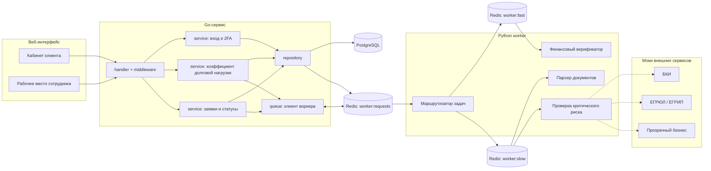
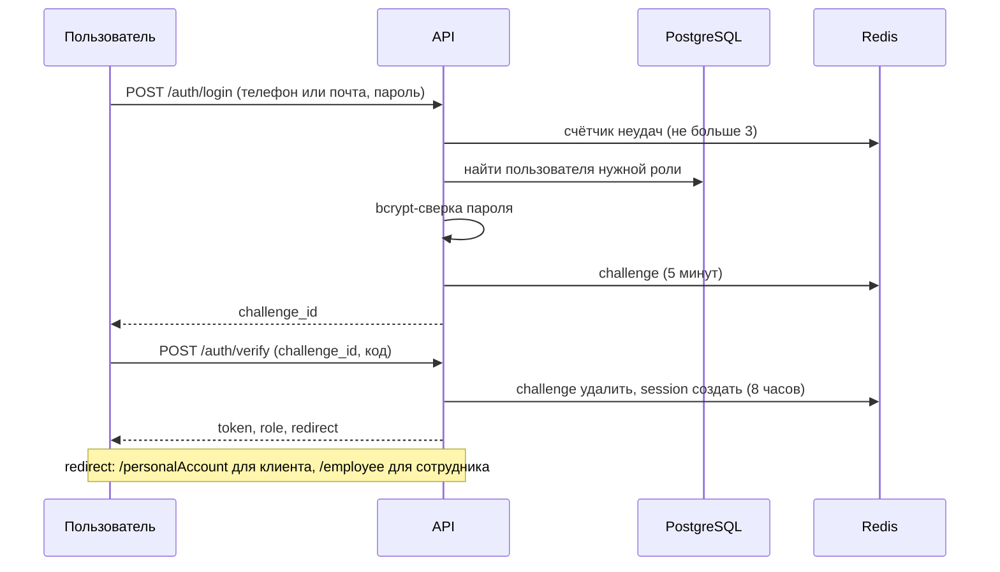
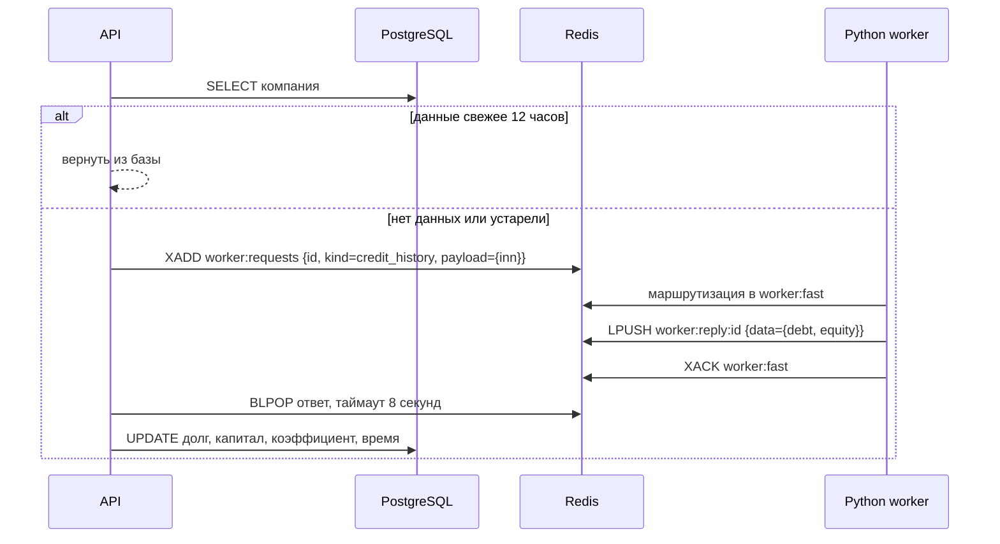

# Архитектура

> Go отвечает за HTTP, авторизацию и хранение. Отдельный Python worker получает задачи через Redis. Проверки заявки, парсинг и риск пока отвечают заглушками; полный процесс заявки ещё не подключён к REST API.

Правило слоёв: хендлер вызывает только сервис, сервис вызывает репозиторий и клиент воркера через интерфейсы. Ни хендлер, ни сервис не работают с Redis и SQL напрямую.

## Вход

Вход состоит из двух шагов, сессия создаётся только после второго. Клиент и сотрудник входят по телефону или почте (на выбор) и паролю, роль выбирает переключатель на странице; код второго фактора сейчас заглушка.

- На любую ошибку учётных данных (нет пользователя, неверный пароль, не та роль) ответ один и тот же, чтобы нельзя было перебирать пользователей.
- Неудачные попытки считаются и на введённый логин, и на самого пользователя, поэтому смена телефона на почту не даёт новых попыток.
- После трёх неверных паролей вход блокируется на 15 минут; после трёх неверных кодов challenge аннулируется.
- Куда перенаправить, решает сервер по роли. Доступ к маршрутам защищают middleware `Authenticate` и `RequireRole`, а не сам редирект.

## Обновление коэффициента долговой нагрузки

После входа клиент вызывает `POST /me/bootstrap`. Это отдельный шаг со своим сервисом, а не часть входа, поэтому его можно вызывать и из других сценариев.

- Ответ ждём списком (`BLPOP`), а не pub/sub: ответ не потеряется, если воркер успел раньше.
- Одновременные запросы одной компании внутри процесса делят один вызов воркера (`singleflight`); запись в базу идемпотентна, так что при нескольких экземплярах API дубликаты безвредны.
- Если данных не было и воркер не ответил за 8 секунд, клиент получает 503 и повторяет запрос. Если данные устарели, а воркер недоступен, возвращаются прежние значения.
- Запросы читаются через consumer groups. Маршрутизатор подтверждает входящее сообщение в одной Redis-транзакции с добавлением его в поток выбранного класса. Исполнитель подтверждает сообщение после записи ответа.

## Два класса задач воркера

Контракты задач и границы решений описаны в [worker-tasks.md](worker-tasks.md).

Все запросы API к воркеру поступают в `worker:requests` в виде `{id, kind, payload}`. Маршрутизатор выбирает класс по зарегистрированному `kind`, а не по пожеланию вызывающей стороны. Далее запрос попадает в один из двух потоков:

| Класс | Поток | Исполнители | Назначение |
|---|---|---:|---|
| Быстрый | `worker:fast` | 8 | `credit_history`, `verify_application` |
| Длительный | `worker:slow` | 2 | Заглушки `parse_documents`, `critical_risk_review`; здесь позже будут парсинг и внешние запросы |

У каждого класса своя consumer group и свои слоты исполнения. Поэтому занятые длительные обработчики не занимают слоты быстрых задач. Маршруты Python-сервисов заданы в `worker/router.py`; сами сервисы лежат в `worker/services/`.

Текущий ответ `{data, error}` возвращается через `worker:reply:<id>` с TTL 1 минута. Этот механизм подходит для `/me/bootstrap`, где API ждёт не более 8 секунд. Для длительных задач нужен отдельный асинхронный контракт: API возвращает ID задания, worker сохраняет состояние и результат в PostgreSQL, клиент получает их отдельным запросом. До появления этого контракта длительные сервисы не подключены к HTTP.

Ограничение текущей версии: после сбоя процесса неподтверждённые сообщения остаются в pending consumer group; автоматический возврат через `XAUTOCLAIM` ещё не реализован. При перезапуске такие сообщения сами не повторятся. Старый поток `credit-history:requests` не переносится автоматически в новый `worker:requests`.

## Поток заявки

1. Клиент отправляет заявку. API сохраняет её в PostgreSQL со статусом `SUBMITTED` и кладёт задачу в Redis вместе с документами.
2. Обработчик берёт задачу из Redis, проверяет данные через моки, считает скоринг и принимает решение.
3. Если данных не хватает, обработчик через Redis отправляет клиенту запрос (`INFO_REQUESTED`). Клиент отвечает тоже через Redis.
4. Сложные случаи и все заявки с негативным скорингом уходят сотруднику (`MANUAL_REVIEW`). Отказ выносит только он, автоматически заявка не отклоняется. Решение сотрудника идёт обратно тем же путём.
5. Итоговый статус и решение сохраняются в заявке в PostgreSQL, клиент видит их в кабинете.

## Компоненты

| Компонент | Назначение | Статус |
|---|---|---|
| Веб-интерфейс (`web/`) | Кабинет клиента и рабочее место андеррайтера | заглушка |
| `handler`, `middleware` | HTTP, аутентификация по токену, проверка роли | вход, `/me/bootstrap` |
| `service` | Вход с 2FA, обновление коэффициента | реализовано |
| `repository` | PostgreSQL (компании, пользователи), Redis (сессии, challenge, счётчики) | реализовано |
| `internal/queue`, `worker/` | Go-клиент Redis, Python-маршрутизатор и четыре маршрута обработки | реализовано; три маршрута с заглушками |
| Заявки и статусы | Жизненный цикл заявки, см. [state-diagram.md](state-diagram.md) | не реализовано |
| Скоринг и решение | Правила риска и кредитное решение | не реализовано |
| Моки ЕГРЮЛ/ЕГРИП, «Прозрачный бизнес» | Проверки данных компании | не реализовано |
| PostgreSQL | Компании, пользователи и заявки | подключено |
| Redis | Сессии, обмен с воркером | подключено |
