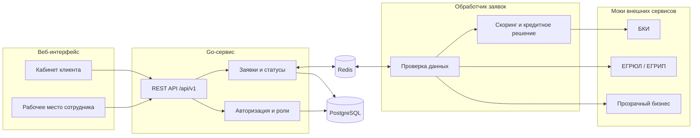

# Архитектура

> Заглушка. Схема отражает целевую архитектуру MVP и будет уточняться по ходу реализации.

## Поток заявки

1. Клиент отправляет заявку. API сохраняет её в PostgreSQL со статусом `SUBMITTED` и кладёт задачу в Redis вместе с документами.
2. Обработчик берёт задачу из Redis, проверяет данные через моки, считает скоринг и принимает решение.
3. Если данных не хватает, обработчик через Redis отправляет клиенту запрос (`INFO_REQUESTED`). Клиент отвечает тоже через Redis.
4. Сложные случаи и все заявки с негативным скорингом уходят сотруднику (`MANUAL_REVIEW`). Отказ выносит только он, автоматически заявка не отклоняется. Решение сотрудника идёт обратно тем же путём.
5. Итоговый статус и решение сохраняются в заявке в PostgreSQL, клиент видит их в кабинете.

## Компоненты

| Компонент | Назначение | Статус |
|---|---|---|
| Веб-интерфейс (`web/`) | Кабинет клиента и рабочее место андеррайтера | заглушка |
| REST API | Единая точка входа для обеих ролей | не реализовано |
| Заявки и статусы | Жизненный цикл заявки, см. [state-diagram.md](state-diagram.md) | не реализовано |
| Обработчик заявок | Проверки, скоринг и решение, получает задачи из Redis | не реализовано |
| Моки внешних сервисов | БКИ, ЕГРЮЛ/ЕГРИП, «Прозрачный бизнес» | не реализовано |
| PostgreSQL | Компании, пользователи и заявки; запускается через docker-compose | сервис в compose есть, приложение пока не подключено |
| Redis | Очередь задач, запросы данных и документы для обработчика; запускается через docker-compose | сервис в compose есть, приложение пока не подключено |
