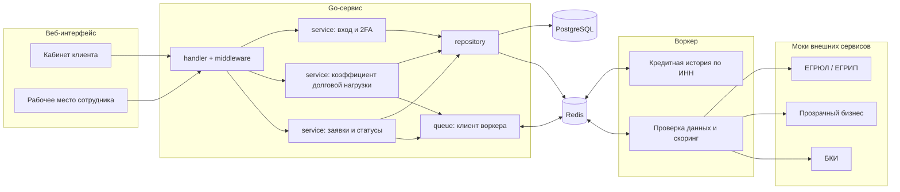
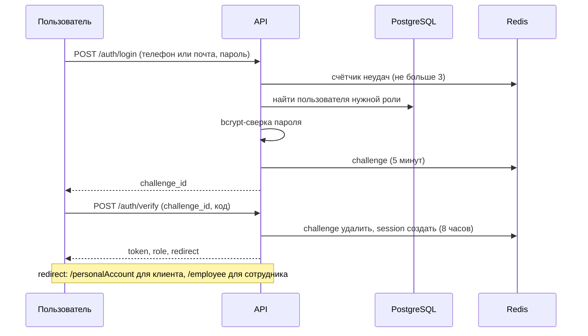
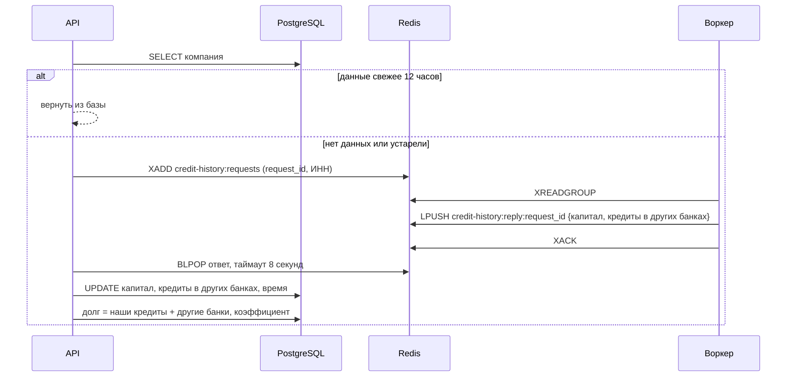

# Архитектура

> Реализованы вход, сессии, каталог, заявки клиента, Redis-обмен с Python worker и приём его результатов в Go API. Python worker проверяет снимок заявки и доступные документы; ручное решение сотрудника и реальные внешние источники ещё в разработке.

Правило слоёв: хендлер вызывает только сервис, сервис вызывает репозиторий и клиент воркера через интерфейсы. Ни хендлер, ни сервис не работают с Redis и SQL напрямую.

## Вход

Вход состоит из двух шагов, сессия создаётся только после второго. Клиент и сотрудник входят по телефону или почте (на выбор) и паролю, роль выбирает переключатель на странице; код второго фактора сейчас заглушка.

- На любую ошибку учётных данных (нет пользователя, неверный пароль, не та роль) ответ один и тот же, чтобы нельзя было перебирать пользователей.
- Неудачные попытки считаются и на введённый логин, и на самого пользователя, поэтому смена телефона на почту не даёт новых попыток.
- После трёх неверных паролей вход блокируется на 15 минут; после трёх неверных кодов challenge аннулируется.
- Куда перенаправить, решает сервер по роли. Доступ к маршрутам защищают middleware `Authenticate` и `RequireRole`, а не сам редирект.

## Обновление коэффициента долговой нагрузки

После входа клиент вызывает `POST /me/bootstrap`. Это отдельный шаг со своим сервисом, а не часть входа, поэтому его можно вызывать и из других сценариев.

- Ответ ждём списком (`BLPOP`), а не pub/sub: ответ не потеряется, если воркер успел раньше.
- Одновременные запросы одной компании внутри процесса делят один вызов воркера (`singleflight`); запись в базу идемпотентна, так что при нескольких экземплярах API дубликаты безвредны.
- Воркер считается недоступным, если он не ответил за 8 секунд или ответил ошибкой. Если данных не было, клиент получает 503 и повторяет запрос. Если данные устарели, возвращаются прежние значения. Причина (таймаут или текст ошибки воркера) пишется в лог.
- Запросы читаются через consumer group и подтверждаются после ответа: запрос, пришедший пока воркер был выключен, не теряется.
- Сообщения, которые воркер прочитал, но не подтвердил (например, упал), через 30 секунд забираются обратно командой `XAUTOCLAIM` и обрабатываются заново.

## Поток заявки

Путь заявки в текущем прототипе (ручное решение сотрудника ещё не подключено):

1. Клиент создаёт черновик (`POST /applications`), автосохраняет его (`PATCH`, нужна актуальная `version`) и отправляет (`POST .../submit`). При отправке проверяются полнота формы и допуск продукта, API сохраняет заявку в PostgreSQL со статусом `SUBMITTED`.
2. Сразу после сохранения заявки `submit` кладёт задачу в Redis (`applications:submitted`) и ставит заявке метку `enqueued_at`. Если отправка не удалась, клиент всё равно получает успешный ответ (заявка уже сохранена), а задачу позже отправит сборщик застрявших заявок (см. ниже).
3. Python worker берёт задачу, проверяет переданный снимок заявки и доступные документы, затем публикует результат в `applications:results`. Статусы и решение в PostgreSQL пишет API (см. «Приём результатов»).
4. Если данных не хватает, статус `INFO_REQUESTED`; хранение вопроса клиенту и ответа пока не реализовано.
5. Сложные случаи и все заявки с негативным скорингом уходят сотруднику (`MANUAL_REVIEW`). Отказ выносит только он, автоматически заявка не отклоняется. Рабочее место сотрудника пока не реализовано.
6. Итоговый статус и решение сохраняются в заявке в PostgreSQL, клиент видит их в кабинете.

## Идемпотентность запросов по заявкам

Изменяющие запросы (`POST /applications`, `PATCH /applications/{id}`, `POST /applications/{id}/submit`) требуют заголовок `Idempotency-Key`: клиент создаёт его сам и повторяет тот же ключ, если не получил ответ. Это middleware `Idempotency`, ключи хранит Redis (`idempotency:<id пользователя>:<ключ>`).

- Первый запрос выполняется, ключ помечается «в работе» (60 секунд), затем ответ сохраняется на 24 часа.
- Повтор с тем же ключом и тем же содержимым (отпечаток: SHA-256 от метода, пути и тела) возвращает прежний ответ с заголовком `Idempotent-Replayed: true`, действие не выполняется второй раз.
- Ключ не передан или некорректен: 400. Ключ уже использован для другого запроса: 422. Запрос с этим ключом ещё выполняется: 409.
- Ответы с ошибкой 5xx не запоминаются, повтор выполнится заново. Ключи разных пользователей не пересекаются.

Идемпотентность по ключу дополняет, а не заменяет защиту в базе: от перезаписи защищает `version`, от двойной отправки условие `status = 'DRAFT'` в самом `UPDATE`.

## Сборщик застрявших заявок

Отправка заявки это запись в Postgres и отдельная запись в Redis (`ApplicationService.Submit` делает вторую сразу после первой), а в двух хранилищах нет общей транзакции. Если между ними случится сбой (упал Redis или процесс), заявка останется в `SUBMITTED`, а воркер о ней не узнает. Страхует это фоновая задача в API (`service.ApplicationSweeper`):
1. Раз в минуту запрос к базе забирает заявки, которые в статусе `SUBMITTED` дольше 2 минут: `UPDATE ... WHERE id IN (SELECT ... FOR UPDATE SKIP LOCKED) RETURNING ...`. Одновременно ставится метка `enqueued_at`, поэтому следующая проверка не возьмёт ту же заявку раньше чем через 2 минуты.
2. `SKIP LOCKED` позволяет запускать несколько экземпляров API: строку, которую уже взял другой, пропускают.
3. Для каждой заявки собирается задача (данные заявки и показатели компании) и кладётся в stream `applications:submitted`.
4. Если сменился статус (воркер приступил к работе), заявка из выборки исчезает.

Повторная отправка безопасна, потому что воркер идемпотентен по `application_id`. Формат задачи: [worker-protocol.md](worker-protocol.md#задачи-по-заявкам-для-воркера-скоринга-черновик-не-согласован).

## Приём результатов воркера скоринга

Воркер скоринга не подключается к базе: о каждом шаге он сообщает сообщением в Redis stream `applications:results`, а статус и решение в Postgres пишет API. Для этого при старте API запускается фоновый цикл (`queue.ResultConsumer`, группа потребителей `api`):
1. Блокирующее чтение `XREADGROUP` ждёт новые сообщения (до 5 секунд, затем снова).
2. Сообщение разбирается и передаётся `service.ResultProcessor`, который проверяет: переход допустим по диаграмме состояний и входит в переходы воркера (проверка данных и скоринг; `REJECTED` и всё, что после `MANUAL_REVIEW`, решает сотрудник), `decision` это JSON-объект.
3. `repository.ApplyResult` выполняет условный `UPDATE ... WHERE id = $1 AND status = $from`: статус меняется, переход дописывается в `history`, `decision` сохраняется, версия растёт. Условие по статусу делает применение идемпотентным.
4. Сообщение подтверждается (`XACK`). Исключение: временный сбой (например, недоступна база): сообщение остаётся «в работе» и через 30 секунд забирается заново (`XAUTOCLAIM`, проверка раз в 10 секунд).
5. Некорректные, повторные, устаревшие и относящиеся к несуществующим заявкам результаты записываются в журнал и подтверждаются.

Сбой Redis не останавливает цикл: после паузы в 2 секунды он продолжает. Несколько экземпляров API делят сообщения группы, но тогда порядок результатов одной заявки не гарантирован (см. [worker-protocol.md](worker-protocol.md#результаты-воркера-скоринга-черновик-не-согласован)).

## Компоненты

| Компонент | Назначение | Статус |
|---|---|---|
| Веб-интерфейс (`web/`) | Калькулятор, вход и кабинет клиента | реализовано; рабочее место андеррайтера в разработке |
| `handler`, `middleware` | HTTP, аутентификация по токену, проверка роли, ключ идемпотентности | вход, `/me/bootstrap`, заявки клиента |
| `service` | Вход с 2FA, обновление коэффициента, заявки, предварительное предложение, сборщик застрявших заявок, применение результатов воркера | реализовано |
| `repository` | PostgreSQL (компании, пользователи, заявки), Redis (сессии, challenge, счётчики, ключи идемпотентности) | реализовано |
| `queue`, `worker/` | Redis-протокол API и Python worker: кредитная история, задачи и результаты заявок | реализовано |
| `catalog` | Каталог 14 продуктов: сроки, допуск, поля формы, документы; проверка полноты и допуска заявки | реализовано, используется при создании, изменении и отправке заявки (публичного `GET /products` пока нет) |
| Заявки и статусы | Жизненный цикл заявки, см. [state-diagram.md](state-diagram.md) | черновик, просмотр, отправка и применение результатов воркера реализованы; возврат в черновик, сотрудник, подписание не реализованы |
| Скоринг и решение | Проверка данных и предварительные риск-флаги | частично реализовано; финальное решение сотрудника в разработке |
| Моки ЕГРЮЛ/ЕГРИП, «Прозрачный бизнес» | Проверки данных компании | не реализовано |
| PostgreSQL | Компании, пользователи и заявки | подключено |
| Redis | Сессии, обмен с воркером | подключено |
