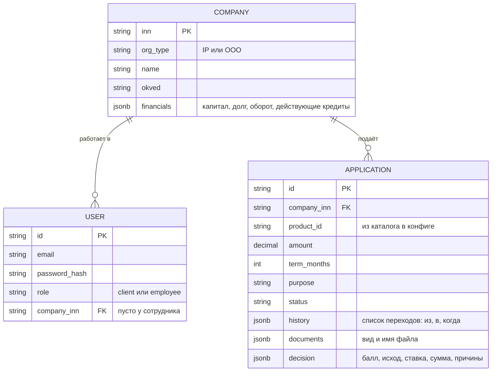

# Модель данных

> Заглушка. Набор полей предварительный и опирается на CJM («Данные на этапе») и заметки команды.

В PostgreSQL три таблицы: компании, пользователи и заявки. Всё, что принадлежит заявке (история статусов, документы, решение), хранится в ней самой, без отдельных таблиц. Каталог продуктов лежит в конфиге приложения. Взаимодействие с обработчиком идёт через Redis.

## Что хранится в PostgreSQL

| Таблица | Что внутри |
|---|---|
| `companies` | Организация клиента. `financials` — синтетические финансовые данные, которые «подтягиваются по ИНН» из мока, включая действующие кредиты |
| `users` | Клиенты и сотрудники банка |
| `applications` | Заявка с историей статусов (`history`), списком документов (`documents`) и решением (`decision`) |

## Что не в PostgreSQL

| Данные | Где | Почему |
|---|---|---|
| Каталог продуктов | конфиг приложения | Статичный список, правится вместе с кодом |
| Очередь заявок на обработку | Redis | Общение API с обработчиком |
| Запросы банка клиенту (`INFO_REQUEST`) и ответы | Redis | Живут пока заявка в обработке |
| Содержимое документов | Redis | Передаются обработчику; в заявке остаются только вид и имя файла |
| Кредит после выдачи | отдельной сущности нет | Выданная заявка (`DISBURSED`, `ACTIVE`) показывается в кабинете как кредит |
