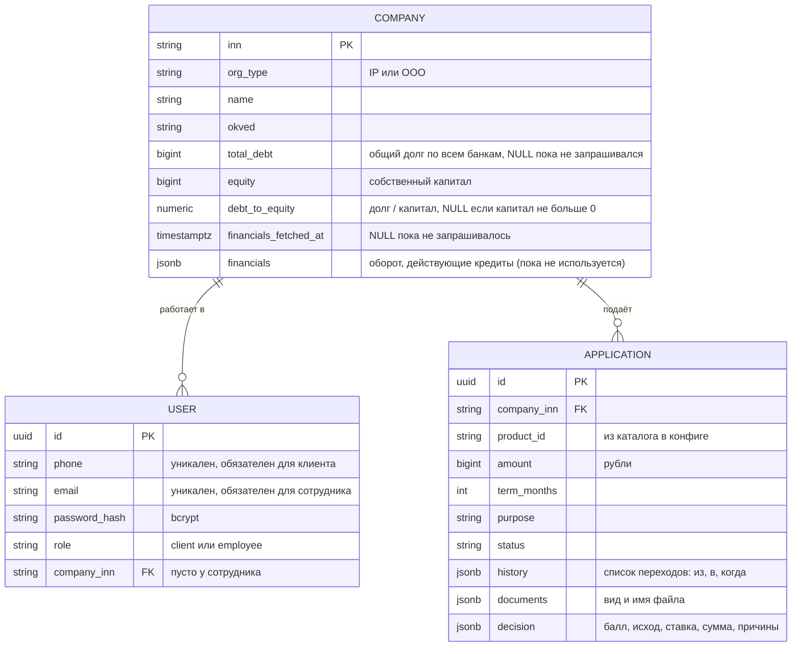

# Модель данных

> Заглушка. Реализованы таблицы `companies` и `users`; `applications` создана миграцией, но приложение её пока не использует.

В PostgreSQL три таблицы: компании, пользователи и заявки. Всё, что принадлежит заявке (история статусов, документы, решение), хранится в ней самой, без отдельных таблиц. Каталог продуктов лежит в конфиге приложения. Временные данные и обмен с воркером живут в Redis.

## Что хранится в PostgreSQL

| Таблица | Что внутри |
|---|---|
| `companies` | Организация клиента и показатели долговой нагрузки из кредитной истории |
| `users` | Клиенты (вход по телефону) и сотрудники банка (вход по почте) |
| `applications` | Заявка с историей статусов (`history`), списком документов (`documents`) и решением (`decision`) |

### Коэффициент долговой нагрузки

- `debt_to_equity` = `total_debt` / `equity`. Чем больше значение, тем выше риск; значение больше 2 ухудшает скоринг.
- `financials_fetched_at IS NULL` означает, что данные ни разу не запрашивались. Это отличает «нет данных» от «коэффициент не определён» (`debt_to_equity IS NULL` при `equity <= 0`).
- Данные считаются устаревшими через 12 часов (`TRUST_REFRESH_INTERVAL`). Обновление запускается после входа клиента, пишет в базу идемпотентный `UPDATE`, поэтому параллельные обновления одной компании безвредны.

## Что не в PostgreSQL

| Данные | Где | Ключ в Redis | Время жизни |
|---|---|---|---|
| Сессия пользователя | Redis | `session:<token>` | 8 часов |
| Вход, ожидающий код 2FA | Redis | `challenge:<id>`, `challenge_attempts:<id>` | 5 минут |
| Счётчик неудачных входов | Redis | `login_fail:<роль>:<телефон или почта>` | 15 минут от первой неудачи |
| Запрос кредитной истории воркеру | Redis stream | `credit-history:requests` | обрезается до 10 000 записей |
| Ответ воркера | Redis list | `credit-history:reply:<request_id>` | 1 минута |
| Запросы банка клиенту (`INFO_REQUEST`) и ответы | Redis | не реализовано | пока заявка в обработке |
| Содержимое документов | Redis | не реализовано | передаются обработчику; в заявке остаются вид и имя файла |
| Каталог продуктов | конфиг приложения | — | статичный список |
| Кредит после выдачи | отдельной сущности нет | — | выданная заявка (`DISBURSED`, `ACTIVE`) показывается в кабинете как кредит |
