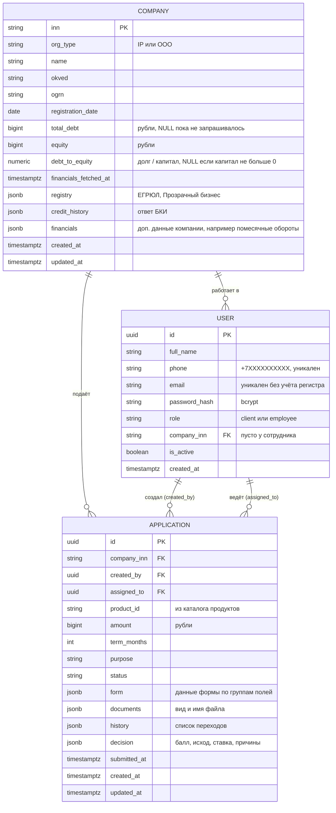

# Модель данных

В PostgreSQL хранятся компании, пользователи, заявки, файлы заявки (`application_documents`) и задания воркера (`worker_jobs`). Метаданные формы, история и решение находятся в `applications`; байты файлов и извлечённые поля — в `application_documents`. Каталог продуктов лежит в приложении ([internal/catalog/products.yaml](../internal/catalog/products.yaml)). Обмен с воркером живёт в Redis.

Базовую схему создаёт [`00001_init.sql`](../migrations/00001_init.sql), демо-данные загружает [`00002_seed_demo_data.sql`](../migrations/00002_seed_demo_data.sql), файлы и задания добавляет [`00003_application_work.sql`](../migrations/00003_application_work.sql).



## Таблицы PostgreSQL

| Таблица | Что внутри |
|---|---|
| `companies` | Организация клиента, данные из реестров (`registry`), БКИ (`credit_history`) и показатели долговой нагрузки |
| `users` | Клиенты и сотрудники банка; войти можно и по телефону, и по почте; отключённые (`is_active = false`) войти не могут |
| `applications` | Заявка с данными формы (`form`), историей статусов (`history`) и решением (`decision`); поле `documents` осталось от ранней схемы и сейчас не используется для файлов |
| `application_documents` | Вид файла, содержимое `bytea`, статус (`UPLOADED`, `PARSED`, `TEXT_EXTRACTED`, `UNSUPPORTED`, `FAILED`) и извлечённые поля с источником и периодом |
| `worker_jobs` | Задания, сохранённые до отправки в Redis, и их результаты |

### Ограничения
- ИНН: 10 цифр у ООО, 12 цифр у ИП (`companies_inn_format_check`).
- Телефон: `+7` и десять цифр (`users_phone_format_check`); почта уникальна без учёта регистра (`users_email_lower_idx`).
- Клиент обязательно имеет телефон и компанию, сотрудник почту и не имеет компании.
- Статус заявки только из 15 допустимых.

### Индексы
- `applications (status, submitted_at)` для очереди сотрудника.
- `applications (company_inn, created_at DESC)` для списка заявок в кабинете.

### Коэффициент долговой нагрузки
- `debt_to_equity` = `total_debt` / `equity`. Чем больше значение, тем выше риск; значение больше 2 ухудшает скоринг.
- `financials_fetched_at IS NULL` означает, что данные ни разу не запрашивались. Это отличает «нет данных» от «коэффициент не определён» (`debt_to_equity IS NULL` при `equity <= 0`).
- Данные считаются устаревшими через 12 часов (`TRUST_REFRESH_INTERVAL`). Обновление запускается после входа клиента и пишет в базу идемпотентный `UPDATE`.

## Данные формы заявки (`applications.form`)

`form` это jsonb-объект с блоками по группам полей: `form.<группа>.<поле>`, например `form.vehicle.vin` или `form.collateral.value`. Какие группы и поля нужны, определяет продукт в каталоге; базовая группа `applicant` (должность `position`, наличие залога `has_collateral`) запрашивается у всех.

```json
{
  "applicant": { "position": "Генеральный директор", "has_collateral": true },
  "collateral": { "type": "vehicle", "description": "Седан", "value": 2500000 },
  "vehicle": { "make": "Toyota", "model": "Camry", "year": 2024, "vin": "JTNB11HK0M3000001" }
}
```

Обязательность полей и документов проверяется в коде по каталогу при отправке заявки (`catalog.MissingFormFields`, `catalog.RequiredDocuments`), база за этим не следит. Суммы, сроки и статус остаются обычными колонками, потому что по ним идут запросы. Расчётные значения (LTV, оборот за 3 месяца, волатильность оборотов) в базе не хранятся, их считает скоринг.

Содержимое `companies.financials` и `companies.credit_history` не имеет жёсткой схемы: `credit_history` это снимок ответа БКИ (кредиты, просрочки, число запросов за 90 дней), `financials` общее место для дополнительных данных компании (например, `turnover_monthly` из выписки).

## Что не в PostgreSQL

| Данные | Где | Ключ в Redis | Время жизни |
|---|---|---|---|
| Сессия пользователя | Redis | `session:<token>` | 8 часов |
| Вход, ожидающий код 2FA | Redis | `challenge:<id>`, `challenge_attempts:<id>` | 5 минут |
| Счётчик неудачных входов | Redis | `login_fail:<роль>:<телефон или почта>` и `login_fail:user:<id>` | 15 минут от первой неудачи |
| Входящие задания воркера | Redis stream | `worker:requests` | до явной очистки |
| Быстрые задания | Redis stream | `worker:fast` | до явной очистки |
| Длительные задания | Redis stream | `worker:slow` | до явной очистки |
| Синхронный ответ воркера | Redis list | `worker:reply:<id>` | 1 минута |
| Результаты заданий заявки | Redis stream | `applications:results` | до явной очистки |
| Запросы банка клиенту (`INFO_REQUEST`) и ответы | Redis | не реализовано | пока заявка в обработке |
| Содержимое документов | PostgreSQL | `application_documents.content` | до удаления документа или заявки |
| Каталог продуктов | [internal/catalog/products.yaml](../internal/catalog/products.yaml) | — | статичный список, встроен в бинарник |
| Кредит после выдачи | отдельной сущности нет | — | выданная заявка (`DISBURSED`, `ACTIVE`) показывается в кабинете как кредит |
