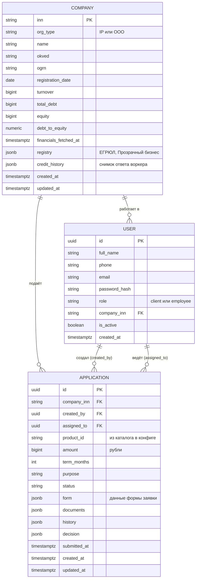

# Предложение по схеме базы данных

> Статус: **в основном реализовано**, схема целиком описана в миграции `00001_init.sql`. Актуальное состояние описано в [data-model.md](data-model.md), здесь сохранено обоснование решений. Принятые решения и отличия от первоначального предложения собраны в конце документа. Документы и их хранение пока не реализованы.

Хранение разделено так: в PostgreSQL лежит то, что нельзя потерять и нужно показывать после перезапуска, в Redis временное и каналы связи с воркером. Продуктовый каталог лежит в конфиге приложения.

## Целевая схема

## Таблица `companies`

| Поле | Тип | Статус | Зачем |
|---|---|---|---|
| `inn` | text, PK | есть | Идентификатор компании |
| `org_type` | text (`IP` / `OOO`) | есть | Тип организации |
| `name` | text | есть | Карточка компании |
| `okved` | text | есть | Основной вид деятельности |
| `total_debt` | bigint, рубли | есть | Общий долг по всем банкам, исходное значение для коэффициента |
| `equity` | bigint, рубли | есть | Собственный капитал |
| `debt_to_equity` | numeric(12,4) | есть | Долг / капитал, используется в скоринге; `NULL`, если капитал не больше 0 |
| `financials_fetched_at` | timestamptz | есть | Когда показатели получены; `NULL`, если ещё не запрашивались. По нему проверяется «старше 12 часов» |
| `ogrn` | text | предлагается | ОГРН или ОГРНИП, нужен для проверки через ЕГРЮЛ/ЕГРИП |
| `registration_date` | date | предлагается | Возраст бизнеса, фактор скоринга |
| `turnover` | bigint, рубли | предлагается | Годовой оборот для лимитов и скоринга (в CJM «обороты по счёту») |
| `registry` | jsonb | предлагается | Ответ моков ЕГРЮЛ и «Прозрачного бизнеса»: руководитель, учредители, адрес, статус |
| `credit_history` | jsonb | предлагается | Снимок ответа воркера: список кредитов, просрочки, число запросов за 90 дней |
| `created_at`, `updated_at` | timestamptz | предлагается | Служебные |

**Изменения относительно текущей схемы**
- Поле `financials` (jsonb) сейчас не используется, его заменяет `credit_history`.
- Три значения (`total_debt`, `equity`, `debt_to_equity`) остаются отдельными колонками, чтобы по ним можно было фильтровать и считать без разбора jsonb.
- Ограничение на ИНН: 10 цифр у ООО, 12 у ИП (`CHECK` по `org_type`). Демо-данные ему уже соответствуют.

## Таблица `users`

| Поле | Тип | Статус | Замечание |
|---|---|---|---|
| `id` | uuid, PK | есть | |
| `phone` | text, unique | есть | Хранится нормализованным: `+7` и десять цифр |
| `email` | text, unique | есть | Хранится в нижнем регистре |
| `password_hash` | text | есть | bcrypt |
| `role` | text (`client` / `employee`) | есть | |
| `company_inn` | text, FK | есть | Обязателен у клиента, пуст у сотрудника |
| `full_name` | text | предлагается | Шапка кабинета и записи «кто принял решение» |
| `is_active` | boolean | предлагается | Возможность отключить пользователя |
| `created_at` | timestamptz | предлагается | Служебное |

**Правки в существующем**
- Уникальность почты должна быть по `lower(email)`, а не по тексту. Сейчас `Client@x` и `client@x` могут существовать одновременно, хотя поиск при входе регистронезависимый.
- Для телефона добавить проверку формата `^\+7\d{10}$`, так как в базе он хранится нормализованным.
- Должность в компании (собственник, директор, бухгалтер) пока не вводится.

## Таблица `applications`

| Поле | Тип | Статус | Замечание |
|---|---|---|---|
| `id` | uuid, PK | есть | |
| `company_inn` | text, FK | есть | |
| `product_id` | text | есть | Ссылка на каталог в конфиге |
| `amount` | bigint, рубли | есть | |
| `term_months` | int | есть | |
| `purpose` | text | есть | |
| `status` | text | есть | Один из 15 статусов, см. [state-diagram.md](state-diagram.md) |
| `documents` | jsonb | есть | Элементы: `kind`, `file_name`, `uploaded_at`, у согласий ещё `signed_at`. Содержимое файлов в базе не хранится |
| `history` | jsonb | есть | Список переходов; в каждую запись добавляются `by` (пользователь, воркер или система) и `comment` |
| `decision` | jsonb | есть | `score`, `outcome`, `rate`, `amount`, `term_months`, `reasons`, а также `decided_by` и `decided_at` |
| `form` | jsonb | предлагается | Всё, что клиент заполнил, кроме основных полей: реквизиты, руководитель, контакты, финансовые показатели, залог |
| `created_by` | uuid, FK на `users` | предлагается | Кто подал заявку от имени компании |
| `assigned_to` | uuid, FK на `users`, может быть пустым | предлагается | Сотрудник, взявший заявку из `MANUAL_REVIEW`, чтобы двое не работали над одной |
| `submitted_at` | timestamptz | предлагается | Сортировка очереди сотрудника |
| `contract` | jsonb | отложено | Договор, график платежей, подпись; добавляется вместе с этапами 06–07 |
| `created_at`, `updated_at` | timestamptz | есть | |

**Пояснения**
- `form` хранится jsonb, а не колонками: форма заявки будет меняться, а обязательность полей проверяется в коде. Суммы и сроки остаются колонками, потому что по ним идут запросы.
- `decided_by` нужен для правила «отказ выносит только сотрудник»: по нему видно, кто принял решение.
- Конкурентные изменения статуса защищает условное обновление `WHERE id = $1 AND status = $from`, отдельное поле версии не требуется.

### Индексы
- `(status, submitted_at)` для очереди сотрудника.
- `(company_inn, created_at DESC)` для списка заявок в кабинете.
- Уникальные индексы на `users.phone` и `lower(users.email)`.

## Что не хранится в PostgreSQL

| Данные | Где | Причина |
|---|---|---|
| Каталог продуктов | конфиг приложения | Статичный список, правится вместе с кодом |
| Запросы банка клиенту (`INFO_REQUEST`) и ответы | Redis | Живут, пока заявка в обработке |
| Содержимое документов | Redis | Передаётся обработчику; в заявке остаются вид и имя файла |
| Сессии, коды 2FA, счётчики неудачных входов | Redis | Временные данные с TTL |
| Очередь задач воркеру и ответы | Redis | Транспорт |
| Журнал аудита | отдельной таблицы нет | Достаточно `history` и `decided_by` |

## Принятые решения

| # | Вопрос | Решение |
|---|---|---|
| 1 | Список действующих кредитов в кабинете | Место под него есть (`companies.credit_history`), но воркер пока возвращает только долг и капитал. Решение откладывается до согласования ответа настоящего воркера |
| 2 | Данные формы: `form` (jsonb) или колонки по продуктам | `applications.form` (jsonb) с блоками по группам полей; поля и документы каждого продукта описаны в каталоге [`internal/catalog/products.yaml`](../internal/catalog/products.yaml). Таблицы на каждый тип кредитования не создаются: у 14 продуктов около восьми повторяющихся наборов полей, а список полей будет меняться |
| 3 | `created_by`, `assigned_to`, `users.full_name` | Добавлены |
| 4 | Правки в `users` и ограничение на ИНН | Внесены: уникальность почты по `lower(email)`, формат телефона, `is_active`, проверка формата ИНН по типу организации |

### Отличия от первоначального предложения
- **`companies.turnover`** не добавлялся. Для овердрафта и ВКЛ нужны оборот за 3 месяца и волатильность, поэтому вместо одной колонки в `companies.financials` будет храниться помесячный ряд из выписки, а производные значения считает скоринг.
- **`companies.financials`** не заменён на `credit_history`, а остаётся общим местом для дополнительных данных компании. `credit_history` добавлен отдельным полем: это данные внешнего источника со своим временем обновления.
- **Данные маркетплейса, наличие РКО, цель покупки** аналитик предлагал хранить в `companies`. Они вводятся клиентом и меняются от заявки к заявке, поэтому лежат в `applications.form` (группы `marketplace`, `rko`, `target_business`).
- **Наличие залога** из базового набора хранится как `form.applicant.has_collateral`, чтобы не конфликтовать с блоком `form.collateral` (тип, описание, стоимость залога).

### Открытые вопросы к аналитику
1. «Стоимость объекта» (цена по договору) и «оценочная стоимость залога» (по отчёту оценки) это одно число или два? От этого зависит расчёт LTV.
2. «Кредит для ИП», «для ООО» и «до 1 млн ₽» это отдельные продукты для клиента или только правила допуска? В каталоге они заведены как продукты без доп. полей.
3. Как имитируем извлечение оборота и капитала из документов?
4. Диапазоны сроков продуктов, которые встречаются в нескольких группах (экспресс-кредит, ВКЛ, базовый залоговый кредит), выбраны мной и требуют подтверждения.
