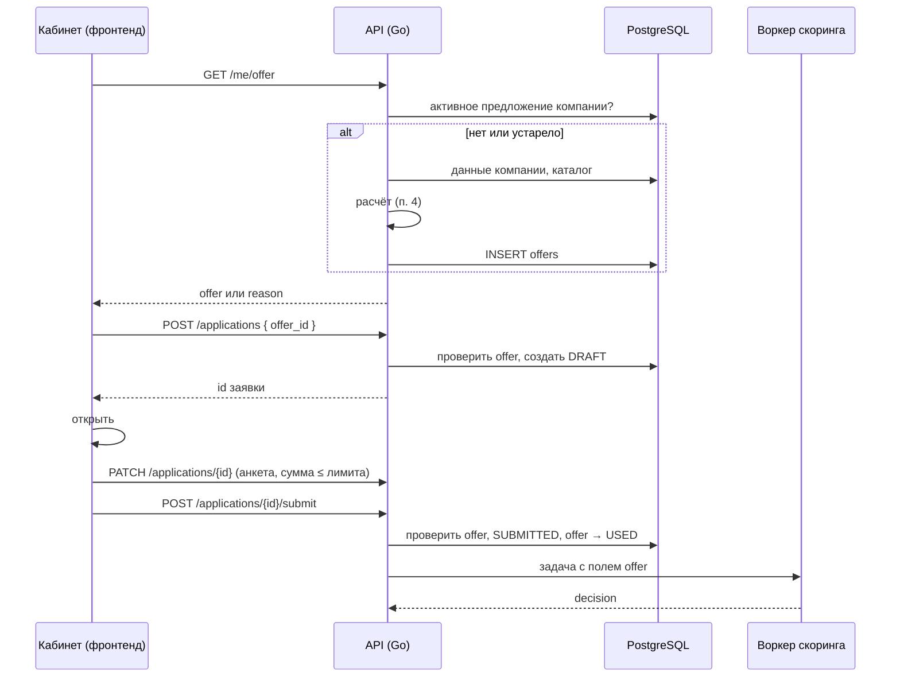
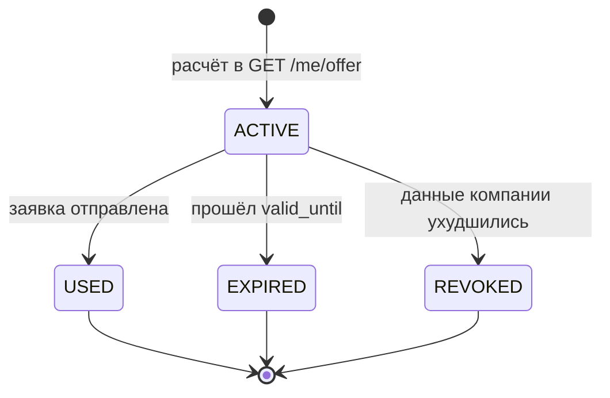

# Предодобренное предложение

> Статус: **реализовано** (шаги 1–5, 7–9 [плана](#12-план-реализации)): расчёт на бэкенде, таблица `offers`, `GET /api/v1/me/offer`, заявка по `offer_id`, баннер и кнопка «Оформить» в кабинете (лимит суммы проверяет сервер, 422 `offer_amount_exceeded`). Не сделаны полная история БКИ (шаг 0, поэтому лимит любого предложения не выше 1 млн ₽), поле `offer` в задаче воркеру (шаг 6) и изменения скоринга (шаг 10).

## Содержание

1. [Что это и зачем](#1-что-это-и-зачем)
2. [Как было до реализации](#2-как-было-до-реализации)
3. [Принятое решение](#3-принятое-решение)
4. [Расчёт предложения](#4-расчёт-предложения)
5. [Хранение](#5-хранение)
6. [API](#6-api)
7. [Поток: от баннера до скоринга](#7-поток-от-баннера-до-скоринга)
8. [Жизненный цикл предложения](#8-жизненный-цикл-предложения)
9. [Фронтенд](#9-фронтенд)
10. [Пограничные случаи](#10-пограничные-случаи)
11. [Решения по спорным вопросам](#11-решения-по-спорным-вопросам)
12. [План реализации](#12-план-реализации)

---

## 1. Что это и зачем

На главной личного кабинета клиент видит баннер:

> **Предварительное предложение: до 3,5 млн ₽**
> Ставка от 17,5% · действует до 24 ноября · меньше документов · окончательное решение после проверки заявки
> [Оформить]

Формулировка выбрана в [п. 11.5](#115-формулировка-в-баннере).

Цель: показать клиенту, на какую сумму он может рассчитывать, и одной кнопкой открыть заявку с уже заполненными продуктом, суммой и сроком.

Предложение **предварительное**. Окончательное решение всегда принимает скоринг при подаче заявки ([scoring.md](scoring.md)).

## 2. Как было до реализации

Таблица описывает исходную заглушку в браузере, которую заменил бэкенд.

| Что | Где | Проблема |
|---|---|---|
| Расчёт лимита | `mock-api.js`, `GET /me/offer` | Считается в браузере, значение можно подменить |
| Формула | `min(30 млн, ((2 × капитал − долг) / 2) вниз до 100 тыс.)`, нет предложения при лимите < 300 тыс. | Не учитывает продукт, возраст бизнеса, БКИ |
| Ставка «от 17%» | константа | Не связана с каталогом продуктов и скорингом |
| «Действует до» | сегодня + 30 дней | Пересчитывается при каждой загрузке, срок никогда не истекает |
| Кнопка «Оформить» | ссылка на `#new-loan` | Лимит в мастер не передаётся, продукт не выбирается |
| Проверка на бэкенде | нет | Бэкенд не знает о предложении |

Исходные данные (долг и капитал) уже настоящие: заглушка берёт их из `POST /me/bootstrap`.

## 3. Принятое решение

- **Расчёт на Go-бэкенде**, в `GET /api/v1/me/offer`. Предложение сохраняется в таблицу `offers`.
- **Фронтенд только показывает** предложение и не содержит формул.
- **Заявка создаётся по `offer_id`**: сумму, срок и продукт сервер берёт из сохранённого предложения, а не из запроса клиента.
- **Скоринг остаётся последним словом**: предложение передаётся воркеру в задаче, но стоп-факторы проверяются всегда.

Почему не фронтенд: значения в браузере можно подменить, а правила кредитования окажутся продублированы ещё в одном месте.

Почему не воркер скоринга: баннер нужен синхронно при открытии кабинета, а воркер работает асинхронно через очередь. Полный скоринг к тому же требует данных заявки (залог, анкета), которых на этом этапе нет.

## 4. Расчёт предложения

Это упрощённая предварительная проверка, а не полный скоринг. Используются только данные, которые уже есть в `companies`, и каталог продуктов.

### 4.1. Входные данные

| Данные | Источник |
|---|---|
| `total_debt`, `equity`, `debt_to_equity` | `companies`, заполняет воркер кредитной истории |
| `org_type`, `registration_date` | `companies` |
| `credit_history` | `companies.credit_history` (пока всегда `{}`, см. [п. 11.1](#111-нет-данных-бки)) |
| `registry` | `companies.registry` |
| Условия продуктов | [products.yaml](../internal/catalog/products.yaml) |

### 4.2. Стоп-условия: предложения нет

Предложение не формируется, если выполнено хотя бы одно условие. Причина возвращается в поле `reason`.

| Условие | `reason` |
|---|---|
| Нет данных о долге или капитале | `no_data` |
| Капитал ≤ 0 | `no_equity` |
| Текущая просрочка в `credit_history` | `overdue` |
| Красные флаги в `registry` (ликвидация, банкротство, недействующее лицо) | `registry_flags` |
| Нет подходящего продукта | `no_product` |
| Итоговый лимит меньше 300 000 ₽ | `high_debt_load` |

Пустой `credit_history` или `registry` означает «нет сведений», а не «всё чисто». В этом случае предложение формируется с пониженным потолком, а в `basis` пишется, какие проверки не выполнены (см. [п. 11.1](#111-нет-данных-бки)).

### 4.3. Выбор продукта

Кандидаты перечислены в конфигурации (`offer.products` в [products.yaml](../internal/catalog/products.yaml)): `working_capital`, `ooo_loan`, `ip_loan`, `express`, `loan_up_to_1m`. Овердрафт, кредит для селлеров и кредитная линия не предлагаются: им нужны РКО, маркетплейс или выписка, и «самый дешёвый» овердрафт иначе выигрывал бы у оборотного кредита. Из кандидатов берутся продукты, которые:
- беззалоговые (`collateral: none`, проверяется при загрузке каталога);
- доступны для `org_type` компании;
- доступны для возраста бизнеса (требование «от 9 месяцев»).

Из подходящих выбирается продукт с наибольшим лимитом, при равенстве — с наименьшей базовой ставкой.

### 4.4. Лимит

```
запас     = (max_debt_to_equity × капитал − долг) × headroom_share
лимит     = min(запас, макс. сумма продукта, лимит для бизнеса младше 9 мес., потолок без БКИ)
лимит     = округление вниз до 100 000 ₽
```

- Лимит для бизнеса младше 9 месяцев применяется, только если он задан у продукта.
- Потолок без БКИ применяется, только если `credit_history` пустой ([п. 11.1](#111-нет-данных-бки)).

Пример: капитал 5 млн, долг 3 млн → запас (2 × 5 − 3) × 0,5 = 3,5 млн → предложение до 3,5 млн ₽.

Коэффициенты задаются в конфигурации, а не в коде ([п. 11.2](#112-коэффициенты)).

### 4.5. Срок и ставка

- `term_months` — типовой срок продукта из каталога, в пределах его `min_term_months`…`max_term_months`.
- `rate_from` — минимальная ставка, которую может дать формула скоринга: `base_rate` продукта − 1,5 п. п. ([п. 11.3](#113-ставка)).
- `valid_until` — дата расчёта + `validity_days`, **фиксируется при создании** и дальше не меняется.

### 4.6. Изменения в каталоге

Сейчас в `products.yaml` нет сумм, ставок и правил по возрасту бизнеса: они есть только во фронтенде ([loans.js](../web/assets/js/loans.js)) и в ассистенте ([catalog.py](../assistant/domain/catalog.py)). Для расчёта в каталог добавляются поля:

```yaml
- id: working_capital
  min_amount: 100000
  max_amount: 30000000
  base_rate: 19.0
  min_business_age_months: 9  # без поля продукт доступен бизнесу любого возраста
  young_max_amount: 2000000   # потолок для бизнеса младше 9 месяцев; без поля потолка нет
```

Значения сумм, ставок и возраста перенесены из [loans.js](../web/assets/js/loans.js). Смысл полей возраста такой же, как во фронтенде: недоступность молодому бизнесу задаёт `min_business_age_months`, а `young_max_amount` только ограничивает сумму. Границы `min_amount` и `max_amount` теперь у всех продуктов, и `max_amount` проверяется при отправке любой заявки.

## 5. Хранение

### 5.1. Таблица `offers`

```sql
CREATE TABLE offers (
    id            uuid PRIMARY KEY DEFAULT gen_random_uuid(),
    company_inn   text NOT NULL REFERENCES companies (inn),
    product_id    text NOT NULL,
    max_amount    bigint NOT NULL CHECK (max_amount > 0),
    term_months   integer NOT NULL CHECK (term_months > 0),
    rate_from     numeric(5, 2) NOT NULL,
    status        text NOT NULL DEFAULT 'ACTIVE' CHECK (status IN ('ACTIVE', 'USED', 'EXPIRED', 'REVOKED')),
    basis         jsonb NOT NULL,          -- снимок данных, по которым посчитано
    valid_until   timestamptz NOT NULL,
    created_at    timestamptz NOT NULL DEFAULT now(),
    used_at       timestamptz
);

-- У компании не больше одного активного предложения
CREATE UNIQUE INDEX offers_one_active ON offers (company_inn) WHERE status = 'ACTIVE';
```

Пример `basis`:

```json
{
  "total_debt": 3000000,
  "equity": 5000000,
  "debt_to_equity": 0.6,
  "financials_fetched_at": "2026-10-25T09:12:00Z",
  "business_age_months": 31,
  "rule_version": 1
}
```

### 5.2. Связь с заявкой

Колонка `offer_id uuid REFERENCES offers (id)` входит в `CREATE TABLE applications` ([00001_init.sql](../migrations/00001_init.sql), без `ALTER TABLE`). Уникальный индекс `applications_offer_idx` (по `offer_id`, где он не пустой) гарантирует, что по одному предложению создаётся не больше одной заявки.

## 6. API

### 6.1. `GET /api/v1/me/offer`

Возвращает действующее предложение компании. Если его нет, оно истекло или данные компании обновились после расчёта (`financials_fetched_at` новее, чем в `basis`), сервер считает новое.

Есть предложение, `200`:

```json
{
  "offer": {
    "id": "6f1c…",
    "product_id": "working_capital",
    "product_name": "Кредит на пополнение оборотных средств",
    "max_amount": 3500000,
    "term_months": 12,
    "rate_from": 17.5,
    "valid_until": "2026-11-24"
  }
}
```

Нет предложения, `200`:

```json
{ "offer": null, "reason": "high_debt_load" }
```

`reason` нужен фронтенду и ассистенту, чтобы при необходимости объяснить клиенту, почему предложения нет. В баннере он не показывается.

### 6.2. `POST /api/v1/applications` с `offer_id`

```json
{ "offer_id": "6f1c…" }
```

Сервер:
1. проверяет, что предложение принадлежит компании пользователя, имеет статус `ACTIVE` и не истекло;
2. создаёт заявку `DRAFT` с `product_id`, `amount = max_amount`, `term_months` и `offer_id` из предложения;
3. значения `product_id`, `amount`, `term_months` из тела запроса игнорирует.

Ошибки:

| Код | Когда |
|---|---|
| `404` | предложение не найдено или принадлежит другой компании |
| `409` | предложение уже использовано или отозвано |
| `410` | срок действия истёк |

Если черновик по этому предложению уже есть, возвращается он, а не создаётся второй.

### 6.3. Изменение черновика

Клиент может изменить сумму и срок через существующий `PATCH /applications/{id}`. Если у заявки есть `offer_id`:
- сумма может быть меньше `max_amount`, но не больше;
- срок должен быть в пределах продукта;
- смена продукта отвязывает предложение (`offer_id = null`), и заявка становится обычной.

### 6.4. `POST /api/v1/applications/{id}/submit`

К существующим проверкам добавляется, если есть `offer_id`:
- предложение `ACTIVE` и не истекло, иначе `422` с причиной `offer_expired`;
- `amount ≤ max_amount`, иначе `422` с причиной `offer_amount_exceeded`.

После успешной отправки предложение переходит в `USED` (в той же транзакции).

### 6.5. Задача воркеру скоринга

В задачу `applications:submitted` ([worker-protocol.md](worker-protocol.md)) добавляется поле `offer` (если заявка подана по предложению):

```json
{
  "offer_id": "6f1c…",
  "max_amount": 3500000,
  "basis": { "…": "…" }
}
```

Что меняется для заявки по предложению, описано в [п. 11.4](#114-ускоренный-путь). Стоп-факторы (KO1–KO5 из [scoring.md](scoring.md)) воркер проверяет всегда. Если данные компании изменились после расчёта предложения, воркер считает заявку обычной.

## 7. Поток: от баннера до скоринга



## 8. Жизненный цикл предложения



- `EXPIRED` выставляется лениво при обращении к предложению или фоновой задачей (по аналогии со сборщиком в [sweeper.go](../internal/service/sweeper.go)).
- `REVOKED` выставляется при пересчёте в `GET /me/offer`, если новые данные компании дают меньший лимит или стоп-условие. Если новые данные дают лимит больше, старое предложение тоже отзывается, а клиент получает новое.
- Заявка-черновик по отозванному или истёкшему предложению не удаляется. При отправке она получит `422`, и клиенту предлагается обновить параметры.

## 9. Фронтенд

- Из [mock-api.js](../web/assets/js/mock-api.js) удаляется обработчик `GET /me/offer`.
- `renderOffer()` в [cabinet.js](../web/assets/js/cabinet.js):
  - показывает `max_amount`, `rate_from`, `valid_until` и название продукта;
  - кнопка «Оформить» вызывает `POST /applications { offer_id }` и переходит на `#draft=<id>` (маршрут уже есть);
  - при `409` / `410` перезапрашивает `GET /me/offer` и обновляет баннер.
- Мастер заявки открывает черновик как обычно: профиль компании подставляется через `prefill()`. В мастере сумма ограничена `max_amount`, рядом подпись «по предварительному предложению».
- Формул расчёта во фронтенде нет.

## 10. Пограничные случаи

| Случай | Поведение |
|---|---|
| Клиент нажал «Оформить» дважды | Возвращается тот же черновик (п. 6.2) |
| Клиент уменьшил сумму | Допустимо, предложение сохраняется |
| Клиент увеличил сумму через API | `PATCH` или `submit` отвечает `422` |
| Клиент сменил продукт | Предложение отвязывается, заявка обычная |
| Предложение истекло во время заполнения | При отправке `422 offer_expired`, фронт перезапрашивает предложение |
| Данные компании обновились | При следующем `GET /me/offer` пересчёт, старое `REVOKED` |
| Воркер кредитной истории недоступен | Используются сохранённые данные; если их нет — `reason: no_data` |
| Скоринг нашёл просрочку после подачи | Решение по скорингу (`MANUAL_REVIEW` / `COUNTER_OFFER`), клиенту показывается причина |
| Компания моложе 9 месяцев | Только продукты без требования к возрасту, лимит по `young_max_amount` |

## 11. Решения по спорным вопросам

По каждому вопросу перечислены варианты и выбранный. Выбор можно пересмотреть, остальной документ уже написан под него.

### 11.1. Нет данных БКИ

`companies.credit_history` сейчас всегда `{}`: воркер кредитной истории возвращает только долг и капитал ([synthetic.go](../internal/worker/synthetic.go)). Проверка на просрочку не работает.

| Вариант | Плюсы | Минусы |
|---|---|---|
| А. Показывать предложение без проверки | Ничего не меняем | Клиенту с просрочкой обещаем деньги, потом отказ |
| Б. Не показывать, пока нет истории | Честно | Баннера не будет ни у кого, пока не доработан воркер |
| В. Показывать с пониженным потолком и пометкой в `basis` | Баннер работает, риск ограничен | Ещё одно правило в расчёте |
| Г. Доработать воркер, чтобы он отдавал полную историю | Решает проблему в корне | Нужна работа в воркере |

**Выбрано: Г как основное, В как страховка.**
- Синтетический воркер возвращает полный ответ БКИ (просрочки, запросы за 90 дней, длина истории), API сохраняет его в `credit_history`. Это пункт 0 плана реализации.
- Если истории всё же нет (сбой, новая компания), лимит ограничивается `no_bki_cap` (1 000 000 ₽), в `basis` пишется `"bki_checked": false`. Скоринг при подаче проверит БКИ в любом случае.

### 11.2. Коэффициенты

| Вариант | Плюсы | Минусы |
|---|---|---|
| А. Оставить в коде | Быстро | Любое изменение требует релиза, расходится со скорингом |
| Б. Отдельный конфиг предложения | Меняется без кода | Ещё один файл |
| В. Секция в `products.yaml` | Все условия кредитования в одном месте | Каталог становится больше |

**Выбрано: В.** Это продолжает идею одного источника правды для условий. Значения согласованы со скорингом: D/E = 2 совпадает с порогом высокой нагрузки в [test-scenarios.md](test-scenarios.md) и в кабинете.

```yaml
# internal/catalog/products.yaml
offer:
  max_debt_to_equity: 2.0     # порог нагрузки, как в скоринге и кабинете
  headroom_share: 0.5         # какую долю запаса предлагаем
  min_amount: 300000          # меньше — предложения нет
  no_bki_cap: 1000000         # потолок, если нет кредитной истории (п. 11.1)
  validity_days: 30
  products: [working_capital, ooo_loan, ip_loan, express, loan_up_to_1m]
  round_to: 100000
  term_months: 12
  rate_discount: 1.5
  young_business_months: 9
```

### 11.3. Ставка

В [scoring.md](scoring.md) базовые ставки заданы по классам (17 / 22 / 26%) и не совпадают со ставками продуктов, которые клиент видит в калькуляторе (14,5–22% в [loans.js](../web/assets/js/loans.js)).

| Вариант | Плюсы | Минусы |
|---|---|---|
| А. Ставка класса из скоринга | Уже описана | Калькулятор показывает другие цифры |
| Б. Ставка продукта, отдельная от скоринга | Совпадает с калькулятором | Скоринг выдаст другую ставку, клиент увидит расхождение |
| В. `base_rate` продукта в `products.yaml`, скоринг считает от неё | Одна ставка везде | Нужно поправить формулу в scoring.md |

**Выбрано: В.**
- В `products.yaml` у каждого продукта `base_rate` (значения переносятся из `loans.js`, их видит клиент).
- В формуле скоринга `base_rate(cls)` заменяется на `base_rate(product)`. Сдвиг по баллу остаётся: от −1,5 до +6,0 п. п.
- `rate_from` в предложении = `base_rate − 1,5`, то есть минимум, который реально может дать скоринг. Слово «от» тогда честное.
- Калькулятор и ассистент показывают «от `base_rate − 1,5`» по тому же правилу.

### 11.4. Ускоренный путь

| Вариант | Плюсы | Минусы |
|---|---|---|
| А. Ничего не упрощать | Просто | Обещание «меньше документов» не выполняется |
| Б. Меньше документов | Заметно клиенту, риск небольшой | Без выписки нет оборотов для P1 |
| В. Ниже порог `approve` | Больше автоодобрений | Риск растёт, по сути двойной скоринг |
| Г. Без лимита полномочий в пределах предложения | Меньше ручной проверки | Ручная проверка — защита от ошибок модели |

**Выбрано: Б.**
- Для заявки по действующему предложению продуктовые документы (`account_statement`, `financial_statements`) становятся необязательными. Базовые (`passport`, `bki_consent`) остаются обязательными.
- Пороги `approve` и `counter`, стоп-факторы и лимит полномочий не меняются.
- Фактор P1 (платёж к обороту) без выписки считается по оборотам из `companies.financials`, если они есть. Если нет — фактор исключается с перенормировкой весов, как описано в [scoring.md](scoring.md).
- Если клиент всё же загрузил документы, они учитываются как обычно.

### 11.5. Формулировка в баннере

| Вариант | Плюсы | Минусы |
|---|---|---|
| А. «Вам предварительно одобрено до …» | Привлекательно | Звучит как обещание, а скоринг может отказать |
| Б. «Предварительное предложение: до …» + «окончательное решение после проверки» | Честно и всё ещё привлекательно | Длиннее |
| В. «Можем рассмотреть до …» | Безопасно | Слабо, теряется смысл баннера |

**Выбрано: Б.** Текст в [п. 1](#1-что-это-и-зачем). Если продукт выйдет за рамки хакатона, формулировку нужно согласовать с юристами.

## 12. План реализации

| # | Задача | Где |
|---|---|---|
| 0 | Полная синтетическая история БКИ, сохранение в `credit_history` ([п. 11.1](#111-нет-данных-бки)) | `internal/worker/synthetic.go`, `internal/queue/credit_history.go`, `internal/repository/company.go` |
| 1 | Добавить в каталог суммы, `base_rate`, возраст бизнеса, секцию `offer` | `internal/catalog/products.yaml`, `catalog.go` |
| 2 | Миграция: таблица `offers`, колонка `applications.offer_id` | `migrations/` |
| 3 | Сервис расчёта предложения (п. 4) с тестами | `internal/service/offer.go` |
| 4 | `GET /me/offer` | `internal/handler/me.go` |
| 5 | Создание заявки по `offer_id`, проверки в `PATCH` и `submit` | `internal/service/application.go`, `internal/handler/application.go` |
| 6 | Поле `offer` в задаче воркеру | `internal/domain/application_task.go`, `internal/queue/applications.go`, [worker-protocol.md](worker-protocol.md) |
| 7 | Контракт в OpenAPI | [openapi.yaml](openapi.yaml) |
| 8 | Фронтенд: убрать мок, кнопка через `offer_id`, ограничение суммы в мастере | `cabinet.js`, `wizard.js`, `mock-api.js` |
| 9 | Сценарии проверки | [test-scenarios.md](test-scenarios.md) |
| 10 | Формула ставки от `base_rate` продукта, необязательные документы по предложению | [scoring.md](scoring.md), воркер скоринга |
