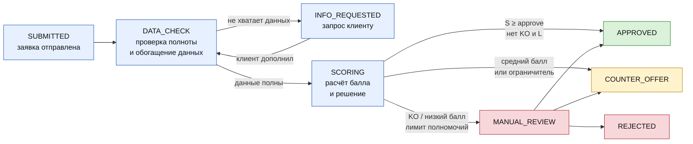
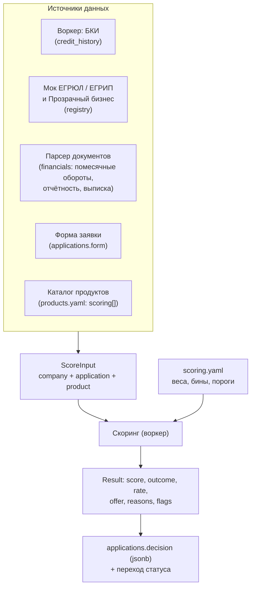
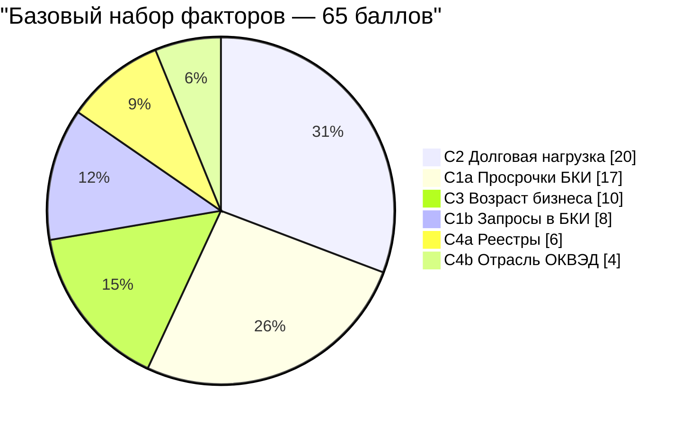
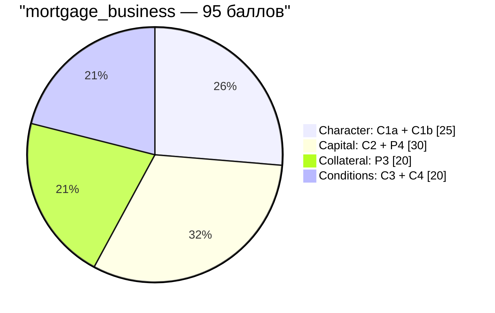
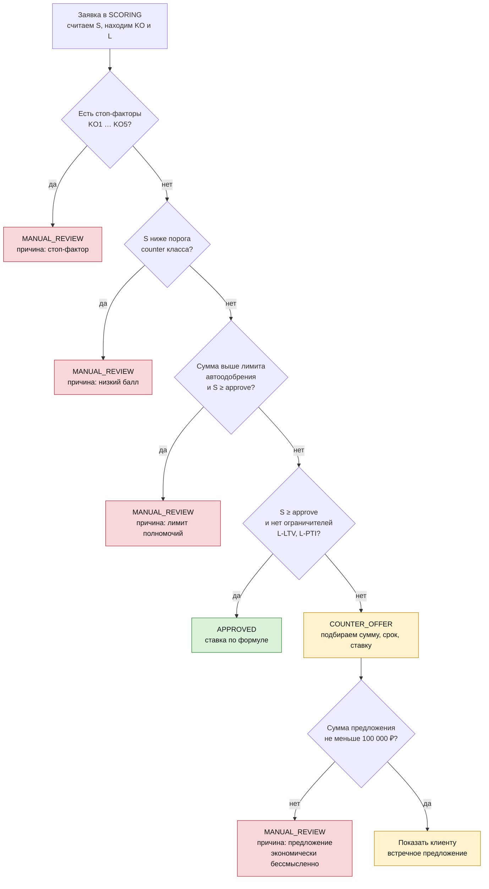
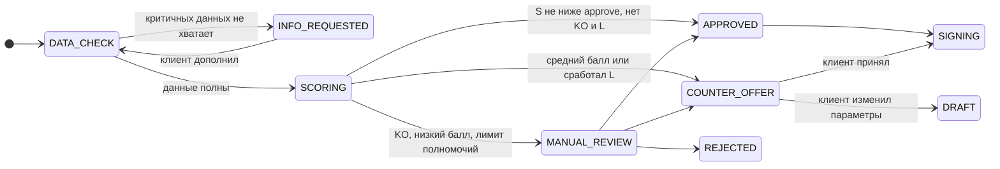
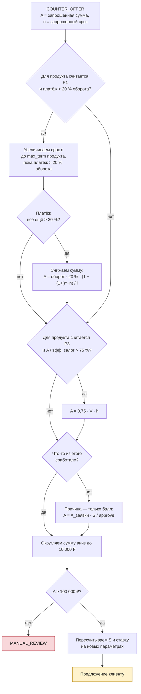
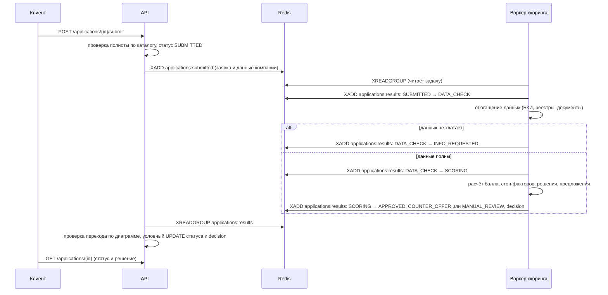
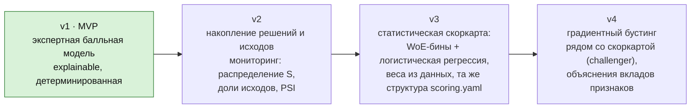

# Скоринг и кредитное решение

> Спецификация скоринга для проекта «Умный кредитный кабинет предпринимателя» (Alfa Hack 2026). Скоринг считает воркер на Python; API передаёт ему данные заявки и записывает результат (раздел [15](#15-интеграция-в-архитектуру), [worker-protocol.md](worker-protocol.md)).
> Документ описывает: из чего складывается балл, как распределены баллы между факторами, как балл превращается в решение, условия встречного предложения, ставку и формат объяснения решения.
>
> Все числа в разделах «Примеры» и «Тестовые сценарии» получены расчётом по формулам этого документа.
> Веса, пороги и ставки подобраны экспертно, без калибровки на реальных дефолтах (их нет, данные синтетические); см. раздел [«Допущения и открытые вопросы»](#14-допущения-и-открытые-вопросы).

---

## Оглавление

1. [Коротко](#1-коротко)
2. [Принципы распределения баллов](#2-принципы-распределения-баллов)
3. [Место скоринга в конвейере](#3-место-скоринга-в-конвейере)
4. [Математическая модель](#4-математическая-модель)
5. [Распределение баллов по факторам](#5-распределение-баллов-по-факторам)
6. [Бины: как значение признака превращается в долю баллов](#6-бины-как-значение-признака-превращается-в-долю-баллов)
7. [Правила поверх балла: стоп-факторы и ограничители](#7-правила-поверх-балла-стоп-факторы-и-ограничители)
8. [Решение: пороги и дерево](#8-решение-пороги-и-дерево)
9. [Встречное предложение](#9-встречное-предложение)
10. [Ставка](#10-ставка)
11. [Объяснение решения (`decision`)](#11-объяснение-решения-decision)
12. [Примеры расчёта](#12-примеры-расчёта)
13. [Тестовые сценарии](#13-тестовые-сценарии)
14. [Допущения и открытые вопросы](#14-допущения-и-открытые-вопросы)
15. [Интеграция в архитектуру](#15-интеграция-в-архитектуру)
16. [Конфигурация `scoring.yaml`](#16-конфигурация-scoringyaml)
17. [Путь развития](#17-путь-развития)

---

## 1. Коротко

```
                 ┌──────────────────────────────────────────────┐
                 │   Балл S ∈ [0; 100]   (50 = нейтральная точка) │
                 └──────────────────────────────────────────────┘

   S = 100 · Σ Wᵢ·rᵢ  /  Σ Wᵢ        суммируем только факторы, применимые к продукту

   Wᵢ  — вес фактора (сколько баллов он «стоит»)
   rᵢ  — доля веса, которую заёмщик «заработал» (0…1), определяется бином значения

   Решение = f( S, стоп-факторы, ограничители, класс продукта, сумма заявки )
```

Три слоя логики, от более строгого к менее строгому:

| Слой | Что это | Результат |
|---|---|---|
| 1. Стоп-факторы (KO) | Обстоятельства, которые нельзя компенсировать баллами (просрочка, ликвидация, отрицательный капитал…) | сразу `MANUAL_REVIEW` |
| 2. Ограничители (L) | Структурные нарушения параметров заявки (слишком высокий LTV, платёж «съедает» оборот) | не выше `COUNTER_OFFER`, параметр исправляется встречным предложением |
| 3. Порог по баллу | Сравнение S с порогами класса продукта | `APPROVED` / `COUNTER_OFFER` / `MANUAL_REVIEW` |

Автоматического отказа нет: `REJECTED` выносит только сотрудник (так заложено в [state-diagram.md](state-diagram.md)).

---

## 2. Принципы распределения баллов

### 2.1. Шесть правил

| № | Принцип | Как реализован |
|---|---|---|
| 1 | **Бюджет — 100 баллов на применимые факторы.** Заявка на ипотеку и на овердрафт сравнимы между собой по шкале 0–100. | Нормировка: делим набранное на сумму весов только применимых факторов |
| 2 | **Вес фактора = значимость × надёжность × трудность манипуляции.** Поведенческие и денежные данные весят больше анкетных. | Три яруса весов: 17–25, 8–10, 4–6 баллов |
| 3 | **Каждый блок риска представлен.** Нельзя получить высокий балл, закрыв глаза на целый блок (модель «5C»). | Сбалансированные блоки, см. 2.2 |
| 4 | **Монотонность.** Хуже значение признака — не больше баллов. Бины без «зубцов». | Проверяется unit-тестом по каждому фактору |
| 5 | **Плохое не компенсируется хорошим.** Факты, после которых автоматическое одобрение недопустимо, вынесены из баллов в правила. | Стоп-факторы и ограничители (раздел 7) |
| 6 | **Скоринг не равен решению.** Одинаковый балл даёт разные исходы для разных продуктов. | Пороги и лимиты зависят от класса продукта (раздел 8) |

### 2.2. Блоки «5C» и их доля в бюджете

Классическая рамка кредитного анализа: **C**haracter, **C**apacity, **C**apital, **C**ollateral, **C**onditions.

| Блок | Что оценивает | Факторы | Баллы | Доля бюджета в `working_capital` (90 б.) |
|---|---|---|---|---|
| **Character** — кредитная дисциплина | Платил ли раньше, не «гонится» ли за кредитами | C1a, C1b | 25 | 27,8 % |
| **Capacity** — платёжеспособность | Хватает ли денежного потока на платёж, стабилен ли он | P1, P2, P6a, P6b | 15–35 | 27,8 % |
| **Capital** — собственные средства | Долговая нагрузка, собственный взнос | C2, P4 | 20–30 | 22,2 % |
| **Collateral** — обеспечение | Покрывает ли залог сумму кредита | P3 | 0–20 | — (нет залога) |
| **Conditions** — профиль и среда | Возраст бизнеса, чистота реестров, отраслевой риск, концентрация | C3, C4a, C4b, P5, P7 | 20–30 | 22,2 % |

Для беззалогового кредита на оборотные средства блоки почти равны по ~¼ бюджета. Для залоговых продуктов добавляется Collateral, и вес распределяется на пять блоков.

### 2.3. Три яруса весов

```
Ярус 1  «деньги и поведение»      17–25 б.   ████████████████████████  C1a 17 · C2 20 · P1 25 · P3 20
Ярус 2  «устойчивость и контекст»  8–10 б.   ██████████                C1b 8 · C3 10 · P2 10 · P4 10 · P5 10 · P6b 10
Ярус 3  «справочные признаки»      4–6 б.    █████                     C4a 6 · C4b 4 · P6a 5 · P7 5
```

Почему так:

- **Ярус 1.** Факты о реальных деньгах и реальном поведении заёмщика. Их трудно приукрасить: данные приходят из БКИ, выписок и документов на залог.
- **Ярус 2.** Значимые признаки, но с меньшей разрешающей способностью (возраст компании, число запросов в БКИ) или применимые узко.
- **Ярус 3.** Сигналы, которые чаще работают как фильтр, чем как градация. Грубые нарушения вынесены в стоп-факторы, а в балл входят только оттенки.

---

## 3. Место скоринга в конвейере



Входы скоринга собираются на шаге `DATA_CHECK`:



---

## 4. Математическая модель

Модель строится по шагам.

### Шаг 1. Набор применимых факторов

У каждого продукта в `products.yaml` есть список `scoring: [...]`. Он определяет, какие продуктовые факторы включаются. Базовые факторы включаются всегда: данные для них собираются при входе клиента и на этапе `DATA_CHECK`.

```
F(p) = F_core ∪ F_prod(p)
F_core = { C1a, C1b, C2, C3, C4a, C4b }
```

Соответствие ключей каталога факторам:

| Ключ в `products.yaml` | Фактор |
|---|---|
| `turnover_monthly`, `turnover`, `marketplace_turnover` | P1 (платёжеспособность) |
| `turnover_volatility` | P2 |
| `has_settlement_account` | P5 |
| `ltv` | P3 |
| `down_payment` | P4 |
| `target_turnover`, `target_profit` | P6a, P6b |
| (поле формы `marketplace.revenue_share`) | P7 |
| `credit_history`, `registry`, `equity`, `total_debt`, `debt_to_equity` | уже в базовом наборе; в `express` это единственные факторы |

### Шаг 2. Доля заработанных баллов по каждому фактору

Для фактора `i` берём значение признака `xᵢ` и по таблице бинов получаем долю:

```
rᵢ = binᵢ(xᵢ) ∈ [0; 1],     rᵢ не убывает при улучшении xᵢ  (монотонность)
```

`rᵢ = 1` — лучший бин, `rᵢ = 0` — худший, `rᵢ = 0,5` — нейтральное значение (применяется при отсутствии данных).

### Шаг 3. Нормированный балл

```
        Σ Wᵢ · rᵢ
S = 100 · ─────────          i ∈ F(p)
          Σ Wᵢ
```

Свойства:

- `S ∈ [0; 100]` без обрезки (если все `rᵢ = 1`, то `S = 100`; если все `rᵢ = 0`, то `S = 0`).
- Продукты с разным числом факторов сравнимы между собой.
- Меньше факторов означает большую долю каждого из них. Поэтому у `express` (только базовые факторы) порог выше (раздел 8).

### Шаг 4. Разложение относительно нейтральной точки

Для объяснения решения балл раскладывается на вклады:

```
Δᵢ = 100 · Wᵢ · (rᵢ − 0,5) / Σ Wⱼ         ⇒     S = 50 + Σ Δᵢ
```

`Δᵢ > 0` — фактор поднимает балл выше нейтральной точки, `Δᵢ < 0` — опускает. Именно по `Δᵢ` выбираются «причины» (раздел 11).

### Шаг 5. Ежемесячный платёж

Для факторов платёжеспособности нужен платёж по аннуитетной схеме:

```
          A · i                  rate_base
PMT = ─────────────── ,    i = ───────────
       1 − (1 + i)^(−n)             12
```

`A` — сумма, `n` — срок в месяцах. В расчёте P1 используется **базовая ставка класса** (без премии за риск). Так мы избегаем цикла «ставка зависит от балла, балл зависит от платежа, платёж зависит от ставки».

### Шаг 6. Решение

```
D(S, K, L, A, cls) =
    MANUAL_REVIEW   если K ≠ ∅                               (есть стоп-факторы)
    MANUAL_REVIEW   если S < counter(cls)
    MANUAL_REVIEW   если A > auto_limit(cls) и S ≥ approve(cls)
    APPROVED        если S ≥ approve(cls) и L = ∅
    COUNTER_OFFER   во всех остальных случаях
```

`K` — множество сработавших стоп-факторов, `L` — множество сработавших ограничителей.

### Шаг 7. Ставка

```
rate = base_rate(cls) + clip( 0,15 · (80 − S), −1,5 ; +6,0 )      [п. п.]
```

### Шаг 8. Встречное предложение

Раздел 9: сумма и срок подбираются как наибольшие значения, при которых нарушенные ограничения снимаются. Затем балл и ставка пересчитываются на новых параметрах.

---

## 5. Распределение баллов по факторам

### 5.1. Таблица факторов

| Код | Фактор | Блок 5C | Вес W | Входные данные | Применяется |
|---|---|---|---|---|---|
| **C1a** | Просрочки в кредитной истории | Character | **17** | `companies.credit_history`: текущая просрочка, число просрочек за 12 мес, закрытые просрочки >30 дн за 24 мес, длина истории | всегда |
| **C1b** | Кредитная активность (запросы в БКИ за 90 дней) | Character | **8** | `credit_history.inquiries_90d` | всегда |
| **C2** | Долговая нагрузка | Capital | **20** | `companies.debt_to_equity`, `equity` | всегда |
| **C3** | Возраст бизнеса | Conditions | **10** | `companies.registration_date` | всегда |
| **C4a** | Чистота реестров | Conditions | **6** | `companies.registry` (ЕГРЮЛ/ЕГРИП, «Прозрачный бизнес») | всегда |
| **C4b** | Отраслевой риск по ОКВЭД | Conditions | **4** | `companies.okved` и справочник риска отраслей | всегда |
| **P1** | Платёж к обороту | Capacity | **25** | платёж (сумма, срок) и средний месячный оборот | `overdraft`, `credit_line`, `working_capital`, `marketplace_seller`, `loan_up_to_1m` |
| **P2** | Стабильность оборота | Capacity | **10** | коэффициент вариации помесячных оборотов | `credit_line` |
| **P3** | Покрытие залогом (LTV) | Collateral | **20** | сумма, оценочная стоимость и тип залога | все залоговые продукты |
| **P4** | Собственный взнос | Capital | **10** | `form.mortgage.down_payment / object_price` | `mortgage_ip`, `mortgage_business` |
| **P5** | РКО в банке | Conditions | **10** | `form.rko.has_settlement_account` | `overdraft` |
| **P6a** | Маржинальность приобретаемого бизнеса | Capacity | **5** | `target_profit / target_turnover` | `business_purchase` |
| **P6b** | Окупаемость приобретаемого бизнеса | Capacity | **10** | `amount / target_profit` (лет) | `business_purchase` |
| **P7** | Концентрация выручки на маркетплейсе | Conditions | **5** | `form.marketplace.revenue_share` | `marketplace_seller` |

Базовый бюджет: `6 факторов = 17 + 8 + 20 + 10 + 6 + 4 = 65 баллов`.



### 5.2. Матрица «продукт × фактор»

`●` — фактор применяется. Колонка «Σ W» — размер бюджета, на который нормируется балл. Колонка «Класс» — к какому классу порогов относится продукт (раздел 8).

| Продукт (`id`) | Класс | C1a | C1b | C2 | C3 | C4a | C4b | P1 | P2 | P3 | P4 | P5 | P6a | P6b | P7 | **Σ W** |
|---|:-:|:-:|:-:|:-:|:-:|:-:|:-:|:-:|:-:|:-:|:-:|:-:|:-:|:-:|:-:|:-:|
| `express` | X | ● | ● | ● | ● | ● | ● | | | | | | | | | **65** |
| `overdraft` | U | ● | ● | ● | ● | ● | ● | ● | | | | ● | | | | **100** |
| `credit_line` | U | ● | ● | ● | ● | ● | ● | ● | ● | | | | | | | **100** |
| `working_capital` | U | ● | ● | ● | ● | ● | ● | ● | | | | | | | | **90** |
| `marketplace_seller` | U | ● | ● | ● | ● | ● | ● | ● | | | | | | | ● | **95** |
| `ip_loan` | U | ● | ● | ● | ● | ● | ● | | | | | | | | | **65** |
| `ooo_loan` | U | ● | ● | ● | ● | ● | ● | | | | | | | | | **65** |
| `loan_up_to_1m` | U | ● | ● | ● | ● | ● | ● | ● | | | | | | | | **90** |
| `equipment_loan` | S | ● | ● | ● | ● | ● | ● | | | ● | | | | | | **85** |
| `auto_loan` | S | ● | ● | ● | ● | ● | ● | | | ● | | | | | | **85** |
| `secured_property_equipment` | S | ● | ● | ● | ● | ● | ● | | | ● | | | | | | **85** |
| `business_purchase` | S | ● | ● | ● | ● | ● | ● | | | ● | | | ● | ● | | **100** |
| `mortgage_ip` | S | ● | ● | ● | ● | ● | ● | | | ● | ● | | | | | **95** |
| `mortgage_business` | S | ● | ● | ● | ● | ● | ● | | | ● | ● | | | | | **95** |

Примечания:

- У `credit_line` залог необязателен (`collateral: optional`). Если клиент его предложил, можно дополнительно включить P3. В MVP не включаем.
- У `ip_loan` и `ooo_loan` в каталоге нет входов сверх базовых, поэтому они оцениваются только по базовому набору.
- Если вы добавляете в каталог ключ `scoring:`, достаточно сопоставить его фактору в таблице из шага 1 раздела 4.

### 5.3. Как выглядит бюджет для разных продуктов

```
working_capital (90 б.)
  Character   C1a C1b            ████████████████████████████  25
  Capital     C2                 ████████████████████          20
  Capacity    P1                 █████████████████████████     25
  Conditions  C3 C4a C4b         ████████████████████          20

auto_loan (85 б.)
  Character   C1a C1b            ████████████████████████████  25
  Capital     C2                 ████████████████████          20
  Collateral  P3                 ████████████████████          20
  Conditions  C3 C4a C4b         ████████████████████          20

mortgage_business (95 б.)
  Character   C1a C1b            ████████████████████████████  25
  Capital     C2 P4              ██████████████████████████████ 30
  Collateral  P3                 ████████████████████          20
  Conditions  C3 C4a C4b         ████████████████████          20

business_purchase (100 б.)
  Character   C1a C1b            ████████████████████████████  25
  Capital     C2                 ████████████████████          20
  Capacity    P6a P6b            ███████████████               15
  Collateral  P3                 ████████████████████          20
  Conditions  C3 C4a C4b         ████████████████████          20
```



---

## 6. Бины: как значение признака превращается в долю баллов

Соглашение: интервалы **[нижняя; верхняя)**, нижняя граница включается, верхняя нет. `r` — доля веса фактора.

### Базовые факторы

**C1a. Просрочки (W = 17).** Берётся *первое подходящее* условие сверху вниз.

| № | Условие | r | Примечание |
|---|---|:-:|---|
| 1 | Текущая просрочка > 30 дней | 0,0 | **стоп-фактор KO1** |
| 2 | Текущая просрочка 1–30 дней | 0,2 | |
| 3 | Были закрытые просрочки > 30 дней за 24 мес | 0,4 | |
| 4 | Три и более просрочки ≤ 30 дней за 12 мес | 0,3 | |
| 5 | Одна–две просрочки ≤ 30 дней за 12 мес | 0,6 | |
| 6 | Просрочек нет, история ≥ 12 мес | 1,0 | |
| 7 | Просрочек нет, история < 12 мес или отсутствует | 0,5 | нейтрально: «нет данных» ≠ «хорошо» |

**C1b. Запросы в БКИ за 90 дней (W = 8).** Частые запросы означают, что клиент ищет деньги в нескольких местах.

| Запросов | r |
|---|:-:|
| 0–2 | 1,0 |
| 3–5 | 0,6 |
| 6 и более | 0,2 |

**C2. Долговая нагрузка `debt_to_equity` (W = 20).** Порог «больше 2 ухудшает скоринг» уже зафиксирован в [data-model.md](data-model.md).

| D/E | r |
|---|:-:|
| [0; 0,5) | 1,0 |
| [0,5; 1) | 0,8 |
| [1; 2) | 0,5 |
| [2; 3) | 0,2 |
| ≥ 3 | 0,0 |
| капитал ≤ 0 (`debt_to_equity IS NULL`) | 0,0 + **стоп-фактор KO3** |
| данные не запрашивались | 0,5 + флаг `data_gap` |

**C3. Возраст бизнеса, месяцев с даты регистрации (W = 10).**

| Возраст | r |
|---|:-:|
| < 6 | 0,0 |
| [6; 12) | 0,2 |
| [12; 36) | 0,5 |
| [36; 60) | 0,8 |
| ≥ 60 | 1,0 |

**C4a. Чистота реестров (W = 6).**

| Условие | r |
|---|:-:|
| Красные флаги: ликвидация, банкротство, недействующее лицо, дисквалификация руководителя | 0,0 + **стоп-фактор KO2** |
| Жёлтые флаги: смена руководителя < 6 мес, недостоверные сведения об адресе | 0,5 |
| Чисто | 1,0 |

**C4b. Отраслевой риск по ОКВЭД (W = 4).** Справочник «ОКВЭД → группа риска» лежит в `scoring.yaml`.

| Группа | r |
|---|:-:|
| Низкий риск | 1,0 |
| Средний риск | 0,6 |
| Высокий риск | 0,2 |

### Продуктовые факторы

**P1. Платёж к обороту (W = 25).** `k = PMT / оборот_мес`

| k | r |
|---|:-:|
| [0; 10 %) | 1,0 |
| [10 %; 20 %) | 0,7 |
| [20 %; 35 %) | 0,3 |
| ≥ 35 % | 0,0; при k > 35 % срабатывает ограничитель **L-PTI** |

Какой оборот брать: для `overdraft`, `credit_line` — средний месячный оборот за последние 6–12 месяцев из выписки; для `working_capital`, `loan_up_to_1m` — годовой оборот / 12 из отчётности; для `marketplace_seller` — средний месячный оборот площадки из отчёта о продажах.

**P2. Стабильность оборота (W = 10).** Коэффициент вариации `CV = σ / μ` помесячных оборотов за 12 мес (минимум 6 месяцев).

| CV | r |
|---|:-:|
| [0; 0,15) | 1,0 |
| [0,15; 0,35) | 0,6 |
| [0,35; 0,60) | 0,25 |
| ≥ 0,60 | 0,0 |
| меньше 6 месяцев данных | 0,5 + флаг `data_gap` |

**P3. LTV (W = 20).** `LTV = A / (V · h)`, где `V` — оценочная стоимость залога, `h` — коэффициент дисконта по типу залога.

| Тип залога | `h` |
|---|:-:|
| `real_estate` | 0,85 |
| `vehicle` | 0,80 |
| `equipment` | 0,70 |
| `other` | 0,50 |

| LTV | r |
|---|:-:|
| [0; 0,50) | 1,0 |
| [0,50; 0,70) | 0,75 |
| [0,70; 0,80) | 0,5 |
| [0,80; 0,90) | 0,2 |
| ≥ 0,90 | 0,0 |

Сверх этого действует ограничитель **L-LTV**: при LTV > 0,80 одобрение на запрошенную сумму невозможно.

**P4. Собственный взнос (W = 10).** `d = down_payment / object_price`

| d | r |
|---|:-:|
| < 10 % | 0,0 |
| [10 %; 20 %) | 0,2 |
| [20 %; 30 %) | 0,5 |
| [30 %; 40 %) | 0,8 |
| ≥ 40 % | 1,0 |

**P5. РКО в банке (W = 10).**

| Условие | r |
|---|:-:|
| Есть расчётный счёт в банке | 1,0 |
| Нет | 0,0 + **стоп-фактор KO5** (овердрафт без РКО невозможен) |

**P6a. Маржинальность приобретаемого бизнеса (W = 5).** `m = target_profit / target_turnover`

| m | r |
|---|:-:|
| < 0 | 0,0 + **стоп-фактор KO4** (убыточный актив) |
| [0; 3 %) | 0,15 |
| [3 %; 8 %) | 0,4 |
| [8 %; 15 %) | 0,7 |
| ≥ 15 % | 1,0 |

**P6b. Окупаемость приобретаемого бизнеса (W = 10).** `T = amount / target_profit`, где `target_profit` — годовая прибыль цели, `T` в годах.

| T | r |
|---|:-:|
| [0; 3) | 1,0 |
| [3; 5) | 0,7 |
| [5; 8) | 0,4 |
| [8; 12) | 0,15 |
| ≥ 12 или прибыль ≤ 0 | 0,0 |

**P7. Концентрация выручки на маркетплейсе (W = 5).** Зависимость от одной площадки: алгоритмы выдачи, комиссии, блокировки.

| Доля выручки через маркетплейс | r |
|---|:-:|
| < 50 % | 1,0 |
| [50 %; 80 %) | 0,6 |
| ≥ 80 % | 0,3 |

---

## 7. Правила поверх балла: стоп-факторы и ограничители

Баллы компенсируют друг друга: сильный оборот поднимает слабую историю. Но некоторые факты нельзя «перекрыть» ничем. Для них нужны правила, а не баллы.

### 7.1. Стоп-факторы (KO) → `MANUAL_REVIEW`

| Код | Условие | Почему нельзя оставить на баллах |
|---|---|---|
| KO1 | Текущая просрочка в БКИ > 30 дней | Реализованный дефолт-сигнал; решение принимает человек |
| KO2 | Красные флаги реестра (ликвидация, банкротство, недействующее лицо, дисквалификация руководителя) | Юридическая невозможность или высокая вероятность исчезновения заёмщика |
| KO3 | Капитал ≤ 0 | D/E не определён, отрицательные чистые активы |
| KO4 | Отрицательная маржа приобретаемого бизнеса (`business_purchase`) | Покупка убыточного актива требует экспертизы |
| KO5 | Нет РКО в банке при заявке на овердрафт | Продукт технически невозможен |

### 7.2. Ограничители (L) → не выше `COUNTER_OFFER`

| Код | Условие | Что исправляет встречное предложение |
|---|---|---|
| L-LTV | LTV > 0,80 | Уменьшает сумму до 75 % эффективной стоимости залога |
| L-PTI | Платёж > 35 % месячного оборота | Увеличивает срок, затем уменьшает сумму, чтобы платёж ≤ 20 % оборота |

Различие между KO и L: после **KO** решать должен человек, после **L** проблему можно решить автоматически, изменив параметры заявки.

### 7.3. Лимит полномочий

Автоматически одобрять можно только суммы не выше лимита класса (раздел 8). Если сумма выше лимита и балл достаточен для одобрения, заявка идёт на `MANUAL_REVIEW`. Это модель «полномочий» кредитного комитета.

### 7.4. Неполные данные

Нехватка критичных данных обрабатывается **до** скоринга на этапе `DATA_CHECK`: заявка переходит в `INFO_REQUESTED`, клиент дополняет данные в кабинете.

| Данных не хватает | Реакция |
|---|---|
| Нет БКИ или финансовых показателей компании | `DATA_CHECK` повторно запрашивает воркер; при недоступности воркера — `INFO_REQUESTED` |
| Нет выписки или отчётности, нужной для P1/P2/P6 | `INFO_REQUESTED` с указанием документа |
| Не хватает поля формы (залог, взнос и т. п.) | `INFO_REQUESTED` (проверка полноты по каталогу уже реализована) |

Если скоринг всё же запущен с пробелом, фактор получает нейтральное значение `r = 0,5`, а в `decision.data_gaps` пишется имя поля. Это страховка, а не основной путь.

---

## 8. Решение: пороги и дерево

### 8.1. Классы продуктов и пороги

Один и тот же балл означает разный риск для разных продуктов: у залогового кредита есть обеспечение, у экспресс-кредита нет ни залога, ни документов. Поэтому у продуктов три класса:

| Класс | Продукты | Порог `approve` | Порог `counter` | Лимит автоодобрения | Базовая ставка (демо) |
|:-:|---|:-:|:-:|---:|:-:|
| **X** — экспресс, мало данных | `express` | **75** | **55** | 1 000 000 ₽ | 26 % |
| **U** — без залога | `overdraft`, `credit_line`, `working_capital`, `marketplace_seller`, `ip_loan`, `ooo_loan`, `loan_up_to_1m` | **70** | **50** | 5 000 000 ₽ | 22 % |
| **S** — залоговые | `equipment_loan`, `auto_loan`, `secured_property_equipment`, `business_purchase`, `mortgage_ip`, `mortgage_business` | **65** | **45** | 20 000 000 ₽ | 17 % |

Шкала баллов (1 символ = 2 балла, слева 0, справа 100):

```
 класс S   ▒▒▒▒▒▒▒▒▒▒▒▒▒▒▒▒▒▒▒▒▒▒░░░░░░░░░░██████████████████    0–44 · 45–64 · 65–100
 класс U   ▒▒▒▒▒▒▒▒▒▒▒▒▒▒▒▒▒▒▒▒▒▒▒▒░░░░░░░░░░███████████████    0–49 · 50–69 · 70–100
 класс X   ▒▒▒▒▒▒▒▒▒▒▒▒▒▒▒▒▒▒▒▒▒▒▒▒▒▒▒░░░░░░░░░░█████████████    0–54 · 55–74 · 75–100

 ▒ MANUAL_REVIEW     ░ COUNTER_OFFER     █ APPROVED
```

Эта шкала описывает только порог по баллу. Стоп-факторы, ограничители и лимит полномочий (разделы 7 и 8.2) могут перевести заявку в более осторожный исход при любом балле.

### 8.2. Дерево решения



### 8.3. Статусы после решения



---

## 9. Встречное предложение

Применяется при исходе `COUNTER_OFFER`. Логика — «исправить то, что нарушено, и ничего лишнего».



Формулы:

```
Целевой платёж:    PMT_target = 20 % · оборот_мес
Макс. сумма по платежу:
    A_pay = оборот_мес · 0,20 · (1 − (1 + i)^(−n)) / i
Макс. сумма по залогу:
    A_ltv = 0,75 · V · h
Предложение:
    A* = floor_10000( min( A_заявки, A_pay, A_ltv ) )         если сработал L или k > 20 %
    A* = floor_10000( A_заявки · S / approve )                 если причина только в баллах
```

Параметры: `PTI_target = 20 %`, `LTV_target = 75 %`, `PTI_max = 35 %`, `LTV_max = 80 %`, минимальная сумма предложения 100 000 ₽, округление 10 000 ₽.

Итоговый балл и ставка в предложении считаются **повторным скорингом** на новых параметрах: если сумма уменьшена, P1 или P3 улучшаются, а ставка снижается. Статус остаётся `COUNTER_OFFER`: клиент должен принять изменённые условия. Переходы `COUNTER_OFFER → SIGNING` и `COUNTER_OFFER → DRAFT` уже есть в диаграмме состояний.

---

## 10. Ставка

```
rate = base_rate(cls) + clip( 0,15 · (80 − S), −1,5 ; +6,0 )      [п. п.]
```

Смысл параметров: точка `S = 80` даёт базовую ставку; каждый балл выше или ниже сдвигает ставку на 0,15 п. п.; сдвиг ограничен снизу −1,5 п. п. (скидка за надёжность), сверху +6,0 п. п. (потолок премии за риск).

| S | Премия, п. п. | `working_capital` (база 22 %) | `auto_loan` (база 17 %) |
|---:|---:|---:|---:|
| 95 | −1,5 | 20,50 % | 15,50 % |
| 90 | −1,5 | 20,50 % | 15,50 % |
| 80 | 0 | 22,00 % | 17,00 % |
| 70 | +1,5 | 23,50 % | 18,50 % |
| 60 | +3,0 | 25,00 % | 20,00 % |
| 50 | +4,5 | 26,50 % | 21,50 % |
| 40 | +6,0 | 28,00 % | 23,00 % |

```
Премия, п. п.
 +6 ┤▓▓▓▓▓▓▓▓▓▓▓▓
 +4 ┤            ▓▓▓▓
 +2 ┤                ▓▓▓▓
  0 ┼─────────────────────▓▓▓▓──────────────
 −2 ┤                         ▓▓▓▓▓▓▓▓▓▓▓▓▓▓
    └──┬────┬────┬────┬────┬────┬────┬────┬──
      40   50   60   70   80   90  100       S
```

Базовые ставки (26 / 22 / 17 %) в документе демонстрационные. Заменяются на актуальные в `scoring.yaml`, формула остаётся.

---

## 11. Объяснение решения (`decision`)

Результат скоринга сохраняется в `applications.decision` (jsonb) и показывается клиенту и андеррайтеру.

### 11.1. Алгоритм выбора «причин»

1. Для каждого применимого фактора считаем вклад `Δᵢ` (шаг 4 раздела 4).
2. Три самых отрицательных `Δᵢ` — **«что снижает балл»**; три самых положительных — **«что повышает балл»**. Факторы с `|Δᵢ| < 1` не показываем.
3. Для сработавших KO и L добавляем отдельные записи (они важнее любых баллов).
4. Каждой записи сопоставляем человекочитаемый текст из словаря (клиентский и сотруднический варианты).

### 11.2. Формат

Пример для заявки на автокредит из раздела 12 (пример C):

```json
{
  "model_version": "scoring-1",
  "product_id": "auto_loan",
  "class": "S",
  "score": 74.1,
  "outcome": "COUNTER_OFFER",
  "thresholds": { "approve": 65, "counter": 45 },
  "ko": [],
  "limiters": ["L-LTV"],
  "offer": { "amount": 1500000, "term_months": 48, "rate": 16.12, "reason": "LTV" },
  "factors": [
    { "code": "C1a", "weight": 17, "r": 1.0, "points": 17.0, "delta": 10.0 },
    { "code": "C1b", "weight": 8,  "r": 1.0, "points": 8.0,  "delta": 4.7 },
    { "code": "C2",  "weight": 20, "r": 1.0, "points": 20.0, "delta": 11.8 },
    { "code": "C3",  "weight": 10, "r": 0.8, "points": 8.0,  "delta": 3.5 },
    { "code": "C4a", "weight": 6,  "r": 1.0, "points": 6.0,  "delta": 3.5 },
    { "code": "C4b", "weight": 4,  "r": 1.0, "points": 4.0,  "delta": 2.4 },
    { "code": "P3",  "weight": 20, "r": 0.0, "points": 0.0,  "delta": -11.8, "value": 1.0 }
  ],
  "reasons_negative": [
    { "factor": "P3", "delta": -11.8, "text": "Сумма кредита равна оценочной стоимости залога с учётом дисконта (LTV 100 %)" }
  ],
  "reasons_positive": [
    { "factor": "C2",  "delta": 11.8, "text": "Низкая долговая нагрузка" },
    { "factor": "C1a", "delta": 10.0, "text": "Нет просрочек в кредитной истории" },
    { "factor": "C1b", "delta": 4.7,  "text": "Мало запросов в БКИ за последние 90 дней" }
  ],
  "data_gaps": []
}
```

Что показывает клиенту кабинет: итог, встречное предложение (сумма, срок, ставка) и 1–3 понятные причины. Что показывает сотруднику: разложение по всем факторам, стоп-факторы и ограничители, исходные значения признаков.

Рядом с интерфейсом сотрудника полезен график «водопад»: от нейтральной точки 50 к итоговому S.

```
Пример C: нейтральная точка 50 → итоговый балл 74,1

 50,0  ┤ нейтральная точка
 +10,0 ┤ ████████████████████ C1a  просрочек нет
  +4,7 ┤ █████████            C1b  запросов мало
 +11,8 ┤ ███████████████████████ C2  D/E 0,4
  +3,5 ┤ ███████              C3   возраст 3 года
  +3,5 ┤ ███████              C4a  реестры чистые
  +2,4 ┤ ████                 C4b  низкий отраслевой риск
 −11,8 ┤ ▒▒▒▒▒▒▒▒▒▒▒▒▒▒▒▒▒▒▒▒▒ P3  LTV 100 %
 ──────┴────────────────────────────────
  74,1   итог
```

---

## 12. Примеры расчёта

Базовый профиль «эталонного клиента» для всех примеров и сценариев:

| Параметр | Значение |
|---|---|
| Капитал | 5 000 000 ₽, D/E = 0,6 |
| Возраст бизнеса | 48 месяцев |
| БКИ | история 36 месяцев, просрочек нет, запросов за 90 дней: 1 |
| Реестр | чисто, ОКВЭД низкого риска |
| Оборот | 2 500 000 ₽/мес, CV = 0,12 |

Значения D/E взяты из тестовых клиентов README (`client1` — 0,6; `client4` — 3,5; `client5` — 0,4). Остальные параметры в примерах заданы условно.

### Пример A. Одобрение: `client1`, кредит на оборотные средства

Заявка: 3 000 000 ₽, 12 месяцев, продукт `working_capital` (класс U, Σ W = 90).

Платёж по базовой ставке 22 %: `PMT ≈ 280 783 ₽`, `k = 280 783 / 2 500 000 = 11,2 %` → бин [10 %; 20 %).

```
Фактор                  W    r     баллов
C1a  просрочки          17   1,0   ████████████████████ 17,0 / 17
C1b  запросы в БКИ       8   1,0   ████████████████████  8,0 /  8
C2   D/E = 0,6          20   0,8   ████████████████░░░░ 16,0 / 20
C3   возраст 48 мес     10   0,8   ████████████████░░░░  8,0 / 10
C4a  реестры чистые      6   1,0   ████████████████████  6,0 /  6
C4b  ОКВЭД низкий        4   1,0   ████████████████████  4,0 /  4
P1   k = 11,2 %         25   0,7   ██████████████░░░░░░ 17,5 / 25
                                                       ────────
                                              Σ = 76,5 / 90

S = 100 · 76,5 / 90 = 85,0       порог approve (U) = 70
```

KO и L нет, сумма 3 млн ≤ 5 млн (лимит) → **APPROVED**.
Ставка: `22 + clip(0,15·(80−85), −1,5; 6) = 22 − 0,75 = 21,25 %`.

### Пример B. Ручная проверка: `client4`, высокая долговая нагрузка

Заявка: 4 000 000 ₽, 12 месяцев, `working_capital`. Условные параметры: возраст 24 мес, три просрочки ≤ 30 дней за 12 мес, 6 запросов за 90 дней, ОКВЭД среднего риска, оборот 1 800 000 ₽/мес.

`PMT ≈ 374 378 ₽`, `k = 20,8 %` → бин [20 %; 35 %). D/E = 3,5.

```
Фактор                  W    r     баллов
C1a  3 просрочки        17   0,3   ██████░░░░░░░░░░░░░░  5,1 / 17
C1b  6 запросов          8   0,2   ████░░░░░░░░░░░░░░░░  1,6 /  8
C2   D/E = 3,5          20   0,0   ░░░░░░░░░░░░░░░░░░░░  0,0 / 20
C3   возраст 24 мес     10   0,5   ██████████░░░░░░░░░░  5,0 / 10
C4a  реестры чистые      6   1,0   ████████████████████  6,0 /  6
C4b  ОКВЭД средний       4   0,6   ████████████░░░░░░░░  2,4 /  4
P1   k = 20,8 %         25   0,3   ██████░░░░░░░░░░░░░░  7,5 / 25
                                                       ────────
                                              Σ = 27,6 / 90

S = 100 · 27,6 / 90 = 30,7       порог counter (U) = 50
```

`30,7 < 50` → **MANUAL_REVIEW**. Главные причины по вкладу в балл: D/E (Δ = −11,1), платёж к обороту (Δ = −5,6), просрочки (Δ = −3,8).

### Пример C. Встречное предложение: `client5`, автокредит

Заявка: 2 000 000 ₽, 48 месяцев, `auto_loan` (класс S, Σ W = 85). Залог — автомобиль, оценка 2 500 000 ₽. Возраст бизнеса 36 мес, D/E = 0,4.

Эффективная стоимость залога: `2 500 000 · 0,80 = 2 000 000 ₽`, `LTV = 2 000 000 / 2 000 000 = 100 %`.

```
Фактор                  W    r     баллов
C1a  просрочек нет      17   1,0   ████████████████████ 17,0 / 17
C1b  запросов мало       8   1,0   ████████████████████  8,0 /  8
C2   D/E = 0,4          20   1,0   ████████████████████ 20,0 / 20
C3   возраст 36 мес     10   0,8   ████████████████░░░░  8,0 / 10
C4a  реестры чистые      6   1,0   ████████████████████  6,0 /  6
C4b  ОКВЭД низкий        4   1,0   ████████████████████  4,0 /  4
P3   LTV = 100 %        20   0,0   ░░░░░░░░░░░░░░░░░░░░  0,0 / 20
                                                       ────────
                                              Σ = 63,0 / 85

S = 100 · 63,0 / 85 = 74,1       порог approve (S) = 65
```

По баллу заявка проходит порог одобрения, но сработал **ограничитель L-LTV** (LTV 100 % > 80 %) → **COUNTER_OFFER**.

Подбор предложения: `A* = 0,75 · 2 000 000 = 1 500 000 ₽`, срок 48 мес.
Повторный скоринг: LTV = 75 % → `r = 0,5` → `P3 = 10`, `Σ = 73 / 85`, `S = 85,9`.
Ставка: `17 + clip(0,15·(80 − 85,9), −1,5; 6) = 17 − 0,88 ≈ 16,12 %`; платёж ≈ 42,6 тыс. ₽ в месяц.

Клиенту: «Мы готовы выдать 1 500 000 ₽ на 48 мес. по ставке 16,12 %: залог покрывает сумму кредита не полностью».

---

## 13. Тестовые сценарии

Для `docs/test-scenarios.md` и юнит-тестов воркера скоринга. «Базовый профиль» — из раздела 12. Результаты получены расчётом по формулам документа.

| № | Сценарий | Продукт, сумма, срок | Отличие от базового профиля | S | Исход | Детали |
|---|---|---|---|---:|---|---|
| S1 | Эталонное одобрение (`client1`) | `working_capital`, 3 млн, 12 мес | — | 85,0 | **APPROVED** | ставка 21,25 % |
| S2 | Высокая долговая нагрузка (`client4`) | `working_capital`, 4 млн, 12 мес | D/E 3,5; 3 просрочки; 6 запросов; возраст 24 мес; оборот 1,8 млн; ОКВЭД средний | 30,7 | **MANUAL_REVIEW** | `S < 50` |
| S3 | Залог не покрывает сумму (`client5`) | `auto_loan`, 2 млн, 48 мес; залог 2,5 млн (`vehicle`) | D/E 0,4; возраст 36 мес | 74,1 | **COUNTER_OFFER** | L-LTV; 1,5 млн/48 мес, 16,12 % |
| S4 | Просрочка > 30 дней | `working_capital`, 3 млн, 12 мес | текущая просрочка 45 дней | 66,1 | **MANUAL_REVIEW** | KO1, несмотря на балл выше 50 |
| S5 | Красный флаг реестра | `working_capital`, 3 млн, 12 мес | ликвидация в реестре | 78,3 | **MANUAL_REVIEW** | KO2, несмотря на балл выше порога approve |
| S6 | Серая зона (средний балл) | `working_capital`, 3 млн, 12 мес | возраст 20 мес; D/E 1,5; 1 просрочка; 4 запроса; ОКВЭД средний; оборот 1,7 млн | 62,1 | **COUNTER_OFFER** | 2,66 млн/12 мес, ставка 24,68 % |
| S7 | Сумма выше лимита автоодобрения | `working_capital`, 6 млн, 12 мес | оборот 6 млн/мес | 93,3 | **MANUAL_REVIEW** | лимит класса U — 5 млн |
| S8 | Отрицательный капитал | `working_capital`, 3 млн, 12 мес | капитал −100 тыс. ₽ | 67,2 | **MANUAL_REVIEW** | KO3 |
| S9 | Нет отчётности для оборотных | `working_capital`, 3 млн, 12 мес | нет `financial_statements` | — | **INFO_REQUESTED** | скоринг не запускается |
| S10 | Экспресс, молодая компания | `express`, 500 тыс., 6 мес | возраст 5 мес; история БКИ отсутствует | 65,4 | **COUNTER_OFFER** | порог X: approve 75; предложение 430 тыс. |
| S11 | Экспресс, эталонный клиент | `express`, 800 тыс., 12 мес | — | 90,8 | **APPROVED** | ставка 24,5 % |
| S12 | Платёж «съедает» оборот | `working_capital`, 3 млн, 12 мес | оборот 0,7 млн/мес | 65,6 | **COUNTER_OFFER** | L-PTI (k = 40 %); 2,12 млн/18 мес |
| S13 | Ипотека для бизнеса | `mortgage_business`, 10 млн, 84 мес; недвижимость 16 млн; взнос 6 млн | — | 81,1 | **APPROVED** | ставка 16,84 % |
| S14 | ВКЛ, умеренно волатильный оборот | `credit_line`, 2 млн, 12 мес | CV = 0,5 | 86,5 | **APPROVED** | P2 даёт 2,5 из 10 |
| S15 | Селлер с высокой концентрацией | `marketplace_seller`, 1,5 млн, 12 мес | оборот площадки 1,8 млн/мес; доля маркетплейса 85 % | 90,0 | **APPROVED** | P7 даёт 1,5 из 5 |
| S16 | Покупка бизнеса, слабое покрытие | `business_purchase`, 8 млн, 60 мес; залог 12 млн (`other`); оборот цели 40 млн, прибыль 3 млн | — | 71,0 | **COUNTER_OFFER** | L-LTV; 4,5 млн |
| S17 | Овердрафт без РКО | `overdraft`, 500 тыс., 2 мес | `has_rko = false` | 76,5 | **MANUAL_REVIEW** | KO5 |

### Свойства, которые нужно проверить автоматически

| Свойство | Как проверять |
|---|---|
| `0 ≤ S ≤ 100` | property-тест на случайных входах |
| Монотонность: ухудшение значения признака не повышает S | для каждого фактора перебор бинов |
| `S = 50 + Σ Δᵢ` | разложение сходится с точностью 0,01 |
| Каждый продукт из каталога имеет непустой набор факторов и `Σ W > 0` | тест по `products.yaml` |
| Любой KO даёт `MANUAL_REVIEW` независимо от S | табличный тест |
| Любой L не допускает `APPROVED` | табличный тест |
| Из скоринга нет перехода в `REJECTED` | тест на множество исходов |
| Повторный скоринг одних и тех же данных даёт тот же результат | детерминизм |

---

## 14. Допущения и открытые вопросы

| № | Допущение | Что нужно сделать |
|---|---|---|
| 1 | Структура `credit_history`: `current_overdue_days`, `overdue_count_12m`, `closed_overdue_gt30_24m`, `history_months`, `inquiries_90d`. Воркер-мок сейчас возвращает только долг и капитал | Расширить ответ воркера кредитной истории и синтетические профили (задача воркеру уже содержит блок `company`, см. [worker-protocol.md](worker-protocol.md)) |
| 2 | Структура `registry`: `red_flags[]`, `yellow_flags[]`, `okved` | Заложить в моки ЕГРЮЛ/ЕГРИП и «Прозрачного бизнеса» |
| 3 | Помесячные обороты берутся из `companies.financials.turnover_monthly` (поле уже упоминается в data-model) | Согласовать с парсером документов, кто пишет эти данные |
| 4 | Веса, пороги и базовые ставки — экспертные, без калибровки на дефолтах | Явно заявить в демо; описать путь калибровки (раздел 17) |
| 5 | Лимиты автоодобрения (1 / 5 / 20 млн ₽) и дисконты залога (0,50–0,85) — условные | Подтвердить у аналитика или заменить значениями из регламента |
| 6 | Платёж в P1 считается по базовой ставке класса, а не по итоговой | Зафиксировано, чтобы не было циклической зависимости |
| 7 | Для `credit_line` `amount` = `desired_limit`, платёж считается как аннуитет на срок линии (консервативная оценка) | Подтвердить |
| 8 | Для `overdraft` платёж по аннуитету на 1–2 месяца ≈ `A / n`; нормативы для овердрафта не уточняются | Оставить как есть для MVP |
| 9 | `target_profit` и `target_turnover` в `business_purchase` — годовые значения | Указать подсказкой в форме |
| 10 | Справочник «ОКВЭД → группа риска» нужно составить | Сделать короткий справочник из ~10 групп отраслей |
| 11 | Переходы `COUNTER_OFFER → DRAFT` и `REJECTED → DRAFT` — допущение из state-diagram, подтверждение этапа 05 CJM остаётся открытым | Подтвердить |

---

## 15. Интеграция в архитектуру

Балл и решение считает воркер скоринга на Python. API не считает скоринг: он передаёт воркеру данные заявки и компании и применяет присланный результат. Воркер не подключается к базе, все обращения к Postgres идут через API.

### 15.1. Последовательность



### 15.2. Что получает воркер и что возвращает

| Направление | Что | Где описано |
|---|---|---|
| API → воркер | Заявка (продукт, сумма, срок, форма, документы), показатели компании (долг, капитал, D/E) и блок `company` (тип организации, ОКВЭД, дата регистрации, `registry`, `credit_history`, `financials`) | [worker-protocol.md](worker-protocol.md), раздел «Задачи по заявкам» |
| Воркер → API | Переход статуса (`from`, `to`), решение `decision` в формате раздела 11, комментарий | [worker-protocol.md](worker-protocol.md), раздел «Результаты воркера скоринга» |

API проверяет только допустимость перехода по [state-diagram.md](state-diagram.md): воркер не может выставить `REJECTED`, состав полей `decision` не проверяется.

### 15.3. Рекомендуемая структура кода воркера

Расчёт стоит отделить от обмена с Redis: чистая функция `score(input) -> result` без обращения к Redis и сети тестируется без инфраструктуры (сценарии S1–S17 и свойства раздела 13).

```
scoring/
├── config      # загрузка scoring.yaml, валидация (Σ весов, монотонность бинов)
├── input       # ScoreInput: данные компании + заявки + продукта
├── factors     # расчёт r каждого фактора (C1a … P7)
├── rules       # стоп-факторы KO1…KO5 и ограничители L-LTV, L-PTI
├── engine      # набор факторов → S → решение
├── offer       # подбор встречного предложения и пересчёт
├── pricing     # ставка по формуле раздела 10
├── reasons     # вклады Δ и тексты причин
└── scoring.yaml
```

---

## 16. Конфигурация `scoring.yaml`

Веса и бины лежат в конфигурации, а не в коде. Жюри и аналитик сверяют модель с документом, не читая код.

```yaml
version: 1
neutral_point: 50

classes:
  X: { approve: 75, counter: 55, base_rate: 0.26, auto_limit: 1000000 }
  U: { approve: 70, counter: 50, base_rate: 0.22, auto_limit: 5000000 }
  S: { approve: 65, counter: 45, base_rate: 0.17, auto_limit: 20000000 }

product_class:
  express: X
  overdraft: U
  credit_line: U
  working_capital: U
  marketplace_seller: U
  ip_loan: U
  ooo_loan: U
  loan_up_to_1m: U
  equipment_loan: S
  auto_loan: S
  secured_property_equipment: S
  business_purchase: S
  mortgage_ip: S
  mortgage_business: S

# какие продуктовые факторы включает ключ из products.yaml → scoring[]
key_to_factor:
  turnover_monthly: P1
  turnover: P1
  marketplace_turnover: P1
  turnover_volatility: P2
  has_settlement_account: P5
  ltv: P3
  down_payment: P4
  target_turnover: P6a
  target_profit: P6b

core_factors: [C1a, C1b, C2, C3, C4a, C4b]

rate:
  anchor_score: 80
  slope_pp_per_point: 0.15
  min_pp: -1.5
  max_pp: 6.0

limiters:
  ltv_max: 0.80
  pti_max: 0.35

counter:
  ltv_target: 0.75
  pti_target: 0.20
  min_offer: 100000
  round_to: 10000

collateral_haircut:
  real_estate: 0.85
  vehicle: 0.80
  equipment: 0.70
  other: 0.50

# бины: x попадает в первый интервал, где x < edges[j]; значений на одно больше, чем границ
factors:
  C1a: { weight: 17, kind: ordered_rules }   # правила из раздела 6, порядок важен
  C1b: { weight: 8,  input: credit_history.inquiries_90d, edges: [3, 6],            values: [1.0, 0.6, 0.2] }
  C2:  { weight: 20, input: debt_to_equity,               edges: [0.5, 1, 2, 3],    values: [1.0, 0.8, 0.5, 0.2, 0.0] }
  C3:  { weight: 10, input: age_months,                   edges: [6, 12, 36, 60],   values: [0.0, 0.2, 0.5, 0.8, 1.0] }
  C4a: { weight: 6,  kind: registry_flags,  red: 0.0, yellow: 0.5, clean: 1.0 }
  C4b: { weight: 4,  kind: industry_risk,   low: 1.0, medium: 0.6, high: 0.2 }
  P1:  { weight: 25, input: payment_to_turnover,          edges: [0.10, 0.20, 0.35], values: [1.0, 0.7, 0.3, 0.0] }
  P2:  { weight: 10, input: turnover_cv,                  edges: [0.15, 0.35, 0.60], values: [1.0, 0.6, 0.25, 0.0], min_months: 6 }
  P3:  { weight: 20, input: ltv,                          edges: [0.5, 0.7, 0.8, 0.9], values: [1.0, 0.75, 0.5, 0.2, 0.0] }
  P4:  { weight: 10, input: down_payment_share,           edges: [0.10, 0.20, 0.30, 0.40], values: [0.0, 0.2, 0.5, 0.8, 1.0] }
  P5:  { weight: 10, kind: boolean, true: 1.0, false: 0.0 }
  P6a: { weight: 5,  input: target_margin,                edges: [0, 0.03, 0.08, 0.15], values: [0.0, 0.15, 0.4, 0.7, 1.0] }
  P6b: { weight: 10, input: payback_years,                edges: [3, 5, 8, 12],     values: [1.0, 0.7, 0.4, 0.15, 0.0] }
  P7:  { weight: 5,  input: marketplace_revenue_share,    edges: [50, 80],          values: [1.0, 0.6, 0.3] }

knockouts:
  KO1: { when: "credit_history.current_overdue_days > 30" }
  KO2: { when: "registry.red_flags is not empty" }
  KO3: { when: "equity <= 0" }
  KO4: { when: "target_margin < 0" }
  KO5: { when: "product == overdraft and not has_settlement_account" }

industry_risk:       # справочник заполняется отдельно
  low:    ["47.11", "47.2", "10.7"]
  medium: ["41.2", "49.41", "56.10"]
  high:   ["41.1", "68.1", "92.1"]
```

Валидации при загрузке конфигурации: для каждого фактора `len(values) = len(edges) + 1`; `values` монотонны; `edges` возрастают; `weight > 0`; у каждого продукта сумма весов применимых факторов больше нуля; `counter < approve` в каждом классе.

---

## 17. Путь развития



| Этап | Что меняется | Что остаётся |
|---|---|---|
| v1 → v2 | Добавляется журнал исходов, метрики качества, отчёт «распределение баллов и исходов по продуктам» | Модель и пороги |
| v2 → v3 | Бины и веса оцениваются по данным: WoE, логистическая регрессия, шкала баллов; пороги подбираются по целевому уровню одобрения и ожидаемым потерям | Структура факторов, KO/L-правила, формат `decision`, `scoring.yaml` |
| v3 → v4 | Вторая модель работает параллельно и не принимает решения (champion / challenger); сравнение качества различения | Решение принимает скоркарта, пока challenger не докажет преимущество |

Дополнительные источники данных, которые встраиваются без изменения структуры: движения по расчётному счёту банка (рост P1/P2 по реальным данным), данные ФНС и налоговая отчётность, данные маркетплейсов (P7 и динамика продаж).

Применение ИИ там, где он создаёт понятную ценность и не подменяет расчёт риска: open-weight LLM может **извлекать признаки** из текстовых документов (бизнес-план, описание цели кредита) и готовить краткое резюме заявки для андеррайтера. Сам балл и решение остаются формализованными и воспроизводимыми.
