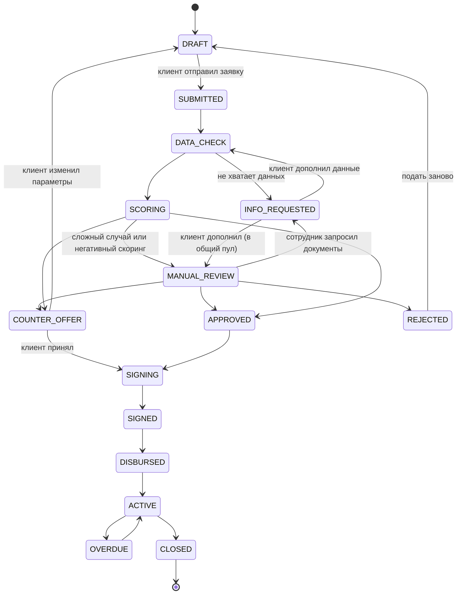

# Диаграмма состояний заявки

Статусы взяты из CJM «Кредитный кабинет».

> Отказ (`REJECTED`) выносит только сотрудник: из `SCORING` прямого перехода в него нет, заявка с негативным скорингом сначала попадает в `MANUAL_REVIEW`.

> Переходы `COUNTER_OFFER → DRAFT` и `REJECTED → DRAFT` («Изменить» и «Подать заново») — наше допущение по этапу 05 CJM, его нужно подтвердить.

> Что реализовано в API: все переходы до `ACTIVE`; переходы воркера ограничены проверкой данных и скорингом ([worker-protocol.md](worker-protocol.md#результаты-воркера-скоринга)). `SIGNING → SIGNED → DISBURSED → ACTIVE` выполняется одним действием клиента «Подписать и получить» (`accept`), подписание и выдача имитируются. Не реализованы `REJECTED → DRAFT` (клиент подаёт новую заявку), `ACTIVE → OVERDUE → ACTIVE` и `ACTIVE → CLOSED` (просрочки и погашения есть только в демо-данных).
