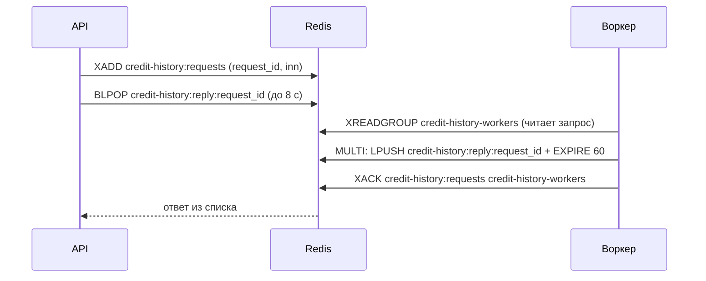

# Обмен API с воркером кредитной истории

Документ описывает контракт между API (Go) и воркером, который по ИНН возвращает кредитную историю. Воркер реализуется отдельно и может быть написан на любом языке: вся связь идёт через Redis. Контракт соответствует коду [`internal/queue/credit_history.go`](../internal/queue/credit_history.go); Go-воркер из `cmd/worker` служит эталонной реализацией и моком для демо.

## Когда это вызывается

Метод `POST /api/v1/me/bootstrap` вызывается клиентом после входа. Если у компании нет показателей долговой нагрузки или они старше 12 часов (`TRUST_REFRESH_INTERVAL`), API обращается к воркеру и ждёт ответа до `WORKER_TIMEOUT` (по умолчанию 8 секунд). Подробный поток описан в [architecture.md](architecture.md#обновление-коэффициента-долговой-нагрузки).

## Схема обмена



Ответ ждём в списке, а не в pub/sub: если воркер ответит раньше, чем API начнёт ждать, ответ не потеряется.

## Запрос (API → воркер)

Сообщение в Redis stream `credit-history:requests`, добавляется командой `XADD` с полями:

| Поле | Тип | Описание |
|---|---|---|
| `request_id` | строка, 32 hex-символа | Уникальный идентификатор запроса; по нему воркер строит ключ ответа |
| `inn` | строка | ИНН компании: 10 цифр у ООО, 12 цифр у ИП |

API обрезает длину stream примерно до 10 000 записей (`MAXLEN ~ 10000`).

## Что делает воркер

1. **Создать группу потребителей** (один раз при старте; ошибку «группа уже существует» `BUSYGROUP` игнорировать). API группу **не создаёт**:
   ```
   XGROUP CREATE credit-history:requests credit-history-workers 0 MKSTREAM
   ```
   Стартовая позиция `0` означает, что воркер обработает и запросы, пришедшие, пока он был выключен.
2. **Читать запросы** через группу, можно запустить несколько воркеров с разными именами потребителей: каждое сообщение достанется одному из них:
   ```
   XREADGROUP GROUP credit-history-workers <имя-потребителя> COUNT 10 BLOCK 5000 STREAMS credit-history:requests >
   ```
3. **Получить кредитную историю** по `inn`.
4. **Ответить** одним сообщением в список `credit-history:reply:<request_id>`. Команды `LPUSH` и `EXPIRE` нужно выполнять **одной транзакцией** (`MULTI` ... `EXEC`): без `EXPIRE` ответ, который API уже не ждёт, останется в Redis навсегда:
   ```
   MULTI
   LPUSH credit-history:reply:<request_id> '{"debt": 2400000, "equity": 4000000}'
   EXPIRE credit-history:reply:<request_id> 60
   EXEC
   ```
5. **Подтвердить сообщение** после отправки ответа, не раньше:
   ```
   XACK credit-history:requests credit-history-workers <id сообщения>
   ```
6. **Периодически забирать «зависшие» сообщения** (рекомендуется): те, что кто-то прочитал, но не подтвердил, например упал. Redis хранит их в списке ожидающих группы, пока их не подтвердят. Команда `XAUTOCLAIM` передаёт текущему потребителю сообщения, которые висят без подтверждения дольше заданного времени (в Go-воркере 30 секунд, проверка раз в 10 секунд):
   ```
   XAUTOCLAIM credit-history:requests credit-history-workers <имя-потребителя> 30000 0-0 COUNT 10
   ```
   Забранные сообщения обрабатываются как обычные (шаги 3–5). Если следующий курсор в ответе не `0-0`, вызов повторяют с ним.

## Ответ (воркер → API)

JSON-объект в списке `credit-history:reply:<request_id>`.

Успех:
```json
{"debt": 2400000, "equity": 4000000}
```

| Поле | Тип | Описание |
|---|---|---|
| `debt` | целое число | Общий долг по всем банкам, рубли |
| `equity` | целое число | Собственный капитал, рубли |

Ошибка:
```json
{"error": "причина"}
```

Если `equity` не больше 0, коэффициент долг / капитал не определён, API сохранит его как `NULL`.

## Как API реагирует

| Ситуация | Что делает API | Что видит клиент `/me/bootstrap` |
|---|---|---|
| Ответ получен | Сохраняет `debt`, `equity`, считает `debt_to_equity` | 200 |
| Воркер не ответил за `WORKER_TIMEOUT`, показатели у компании уже были | Использует прежние значения, пишет предупреждение в лог | 200 со старыми значениями |
| Воркер не ответил, показателей у компании не было | Возвращает ошибку таймаута | 503, `Retry-After: 5` |
| Ответ содержит `error` или это не корректный JSON, показатели у компании уже были | Использует прежние значения, пишет причину в лог | 200 со старыми значениями |
| Ответ содержит `error` или это не корректный JSON, показателей не было | Пишет причину в лог | 503, `Retry-After: 5` |

Ошибка воркера и его молчание обрабатываются одинаково: оба случая считаются «воркер недоступен». Причина (таймаут, текст `error` или ошибка разбора ответа) попадает только в лог API, клиент её не видит.

Проверено на запущенном стеке: ответ `{"error": ...}` и не-JSON дают 200 со старыми данными (когда они были) или 503 (когда не было), молчание воркера даёт то же самое.

## Особенности

- **Повторные запросы.** Несколько клиентов одной компании внутри одного экземпляра API делятся одним запросом (`singleflight`), но при нескольких экземплярах API или после таймаута один и тот же ИНН может прийти несколько раз с разными `request_id`. Каждый запрос нужно обработать независимо.
- **Запоздалые ответы.** API ждёт не дольше 8 секунд. Если воркер ответил позже, ответ остаётся в списке до истечения `EXPIRE` и безвреден.
- **Накопившиеся запросы.** После простоя воркер получит все накопившиеся запросы, и ответы на уже неактуальные просто истекут по `EXPIRE`.
- **Необработанные сообщения.** Сообщение, которое воркер прочитал, но не подтвердил (например, упал), в группе остаётся «зависшим». Go-воркер забирает такие сообщения обратно через 30 секунд (шаг 6) и обрабатывает; проверено: после имитации падения 5 зависших сообщений были обработаны за 34 секунды. Для API это безопасно и без дочитки: клиент к этому моменту уже получил 503 или старые данные.
- **Авторизация и TLS в Redis** сейчас не используются.

## Ручная проверка без воркера

Позволяет «сыграть» воркера командами `redis-cli`. В примере воркер в compose остановлен (`docker compose stop worker`), а клиент `+79990000002` (данных у компании нет) уже получил токен (см. [requests.http](requests.http)).

1. В одном терминале вызвать `POST /api/v1/me/bootstrap`: запрос повиснет на несколько секунд.
2. В другом терминале быстро (в пределах 8 секунд) найти запрос:
   ```bash
   docker compose exec redis redis-cli XREVRANGE credit-history:requests + - COUNT 1
   ```
   В выводе третья строка это `request_id`, пятая `inn`.
3. Положить ответ, подставив `request_id`:
   ```bash
   docker compose exec redis redis-cli LPUSH credit-history:reply:ВАШ_REQUEST_ID '{"debt":2400000,"equity":4000000}'
   ```
4. Первый терминал вернёт 200 с коэффициентом 0,6. Вместо JSON с суммами можно положить `{"error":"boom"}`: для компании без данных будет 503, для компании с устаревшими данными (клиент `+79990000003`) 200 со старыми значениями.

Эта процедура проверена на реальном стеке.

## Задачи по заявкам для воркера скоринга (черновик, не согласован)

> Формат ниже предложен нами и **не согласован** с воркером скоринга. Со стороны API реализованы отправка задачи (сразу при отправке заявки и повторно сборщиком застрявших заявок) и приём результатов (`applications:results`, см. следующий раздел).

API кладёт задачу в Redis stream `applications:submitted` командой `XADD` (длина stream обрезается примерно до 10 000 записей) в двух случаях: сразу после того, как клиент отправил заявку (`POST /applications/{id}/submit`), и позже, если заявка долго остаётся в `SUBMITTED` (сборщик, см. ниже). Поля сообщения:

| Поле | Тип | Описание |
|---|---|---|
| `application_id` | строка (UUID) | Идентификатор заявки; по нему воркер должен быть идемпотентным |
| `inn` | строка | ИНН компании |
| `product_id` | строка | Продукт из каталога (`internal/catalog/products.yaml`) |
| `amount` | целое число | Сумма, рубли |
| `term_months` | целое число | Срок, месяцы |
| `form` | JSON-строка | Данные формы блоками `группа.поле` |
| `documents` | JSON-строка | Загруженные документы: `[{"kind": "passport", "name": "паспорт.pdf", "path": "<id заявки>/passport/паспорт.pdf"}]`; `path` — путь внутри тома с документами (в compose том `documents`, у API смонтирован в `/data/documents`); список может быть пустым |
| `company` | JSON-строка | Сведения о компании, которые у нас уже есть (воркер к базе не подключается): `org_type` (`IP` или `OOO`), `okved`, `registration_date` (`YYYY-MM-DD`, поля нет, если дата неизвестна), `registry`, `credit_history`, `financials`. Три последних это JSON-объекты в том виде, как сохранены; если данных нет, пустой объект `{}`. Воркер может взять оттуда уже известное и запросить только недостающее |
| `debt`, `equity` | целое число | Долг и капитал компании, рубли; поля отсутствуют, если показатели ещё не получены |
| `debt_to_equity` | число строкой | Долг / капитал; поле отсутствует, если не определён |

Пример:
```
XADD applications:submitted * application_id 8c1f… inn 7700000002 product_id express amount 500000 term_months 6 \
  form '{"applicant":{"has_collateral":false,"position":"Директор"}}' documents '[]' \
  company '{"org_type":"OOO","okved":"41.20","registration_date":"2022-09-01","registry":{"status":"ACTIVE"},"credit_history":{},"financials":{}}' \
  debt 2400000 equity 4000000 debt_to_equity 0.6
```

**Отправка при `submit`.** После сохранения заявки в Postgres API сразу отправляет задачу и ставит заявке метку `enqueued_at`. Если отправка не удалась, клиент всё равно получает успешный ответ, а задачу позже отправит сборщик.

**Сборщик застрявших заявок.** Заявка записывается в Postgres, а задача в Redis: это два хранилища, и между ними возможен сбой. Фоновая задача в API раз в минуту находит заявки, которые больше 2 минут остаются в `SUBMITTED` (воркер первым же сообщением сменил бы статус), и отправляет задачу заново. Заявки, статус которых сменился, не отправляются. Отсчёт идёт от метки `enqueued_at` (а если задача ещё не уходила, от времени отправки заявки), поэтому следующая повторная отправка возможна не раньше чем через 2 минуты (на практике 2–3 из-за шага проверки в минуту). Поэтому **воркер скоринга обязан быть идемпотентным по `application_id`**: одну заявку он может получить несколько раз (например, если воркер не успел сменить статус за 2 минуты).

## Результаты воркера скоринга (черновик, не согласован)

> Формат предложен нами и **не согласован** с воркером. Со стороны API реализован полностью.

Воркер сообщает о каждом шаге обработки заявки сообщением в Redis stream `applications:results` (команда `XADD`). Статусы и решение в Postgres пишет только API: воркер к базе не подключается. API читает stream через consumer group `api` (группа создаётся при старте API с позиции `0`, поэтому результаты, пришедшие пока API был выключен, не теряются), применяет результат и подтверждает сообщение.

| Поле | Обязательно | Описание |
|---|---|---|
| `application_id` | да | Идентификатор заявки (UUID), тот же, что в задаче |
| `from` | да | Статус, в котором по мнению воркера заявка находится сейчас |
| `to` | да | Новый статус |
| `event_id` | нет | Уникальный идентификатор события; попадает в журнал API, помогает искать сообщения |
| `decision` | нет | JSON-объект решения (формат в разделе 11 [scoring.md](scoring.md); состав полей API не проверяет); записывается в `applications.decision` как есть |
| `comment` | нет | Пояснение, добавляется к записи в истории заявки |

Пример: скоринг завершён, заявка одобрена.
```
XADD applications:results * event_id 9c3e application_id 8c1f… from SCORING to APPROVED \
  decision '{"score":82.5,"outcome":"APPROVED","rate":18.5,"amount":500000,"term_months":6,"reasons":["стабильный оборот"]}' comment scored
```

**Какие переходы может присылать воркер.** Права воркера заданы переходами, а не статусами: он выполняет автоматическую проверку данных и скоринг, а всё, что после ручной проверки, решает сотрудник.

| Переход | Что означает |
|---|---|
| `SUBMITTED → DATA_CHECK` | воркер взял заявку в работу (присылать первым, сразу после получения задачи) |
| `DATA_CHECK → SCORING` | данных достаточно, идёт расчёт |
| `DATA_CHECK → INFO_REQUESTED` | не хватает данных или документа, нужен ответ клиента |
| `SCORING → APPROVED` | автоматическое одобрение |
| `SCORING → COUNTER_OFFER` | встречное предложение (условия в `decision.offer`) |
| `SCORING → MANUAL_REVIEW` | нужна ручная проверка сотрудником; на этом работа воркера по заявке заканчивается |

Любой другой переход отклоняется, даже если он есть в [диаграмме состояний](state-diagram.md). В частности, воркер не может:
- присылать `REJECTED`: автоматического отказа нет, отказ выносит только сотрудник;
- менять заявку в `MANUAL_REVIEW` (например, `MANUAL_REVIEW → APPROVED`): это решение сотрудника;
- возвращать заявку из `INFO_REQUESTED` в `DATA_CHECK`: это происходит, когда клиент дополнил данные.

**Как API применяет результат.** Одним условным запросом: `UPDATE ... SET status = to ... WHERE id = application_id AND status = from`. Статус меняется, в `history` дописывается переход (`by: "worker"`), `decision` сохраняется, если пришёл, версия заявки растёт на 1.

| Ситуация | Что делает API |
|---|---|
| Результат применён | Подтверждает сообщение |
| Такой же результат пришёл повторно (статус уже равен `to`) | Ничего не меняет, пишет в журнал «duplicate», подтверждает |
| Статус заявки не равен `from` (результат устарел или пришёл раньше предыдущего) | Ничего не меняет, пишет в журнал, подтверждает |
| Заявки нет или идентификатор не UUID | Пишет в журнал, подтверждает |
| Сообщение некорректно: нет обязательного поля, неизвестный статус, переход не по диаграмме или не из списка переходов воркера (`REJECTED`, решение вместо сотрудника), `decision` не JSON-объект | Пишет причину в журнал, подтверждает (повтор не поможет) |
| Временный сбой (например, недоступна база) | **Не подтверждает**: сообщение остаётся «в работе» и забирается заново примерно через 30–40 секунд (`XAUTOCLAIM`) |

Проверено на запущенном стеке: все строки таблицы, включая повторную обработку после остановки базы (применено через 30 секунд после её возвращения).

**Требования к воркеру:**
- Присылать результаты **по одной заявке строго по порядку** и по возможности по одному за раз (следующий `from` равен предыдущему `to`). Пока экземпляр API один, он обрабатывает сообщения по очереди; при нескольких экземплярах API результаты одной заявки могут быть обработаны не по порядку, и опередивший результат будет отклонён как «устаревший».
- Допустимы повторные сообщения: применение идемпотентно.

**Не реализовано:** поле `info_request` (вопрос клиенту при `INFO_REQUESTED`) API пока не читает и нигде не сохраняет. Статус при этом применяется. Где хранить вопрос, ещё не решено (раньше обсуждали Redis).

## Открытые вопросы

- Как воркер должен отвечать на неизвестный ИНН: сейчас любое поле `error` трактуется как временная недоступность, и клиент без данных получает 503 с просьбой повторить. Различать «временная ошибка» и «ИНН не существует» API пока не умеет; для этого понадобился бы код ошибки в ответе воркера.
- Нужны ли воркеру дополнительные поля (список кредитов, просрочки, число запросов за 90 дней): место для них в базе есть (`companies.credit_history`, jsonb), см. [data-model.md](data-model.md).
- Нужна ли аутентификация воркера в Redis.
