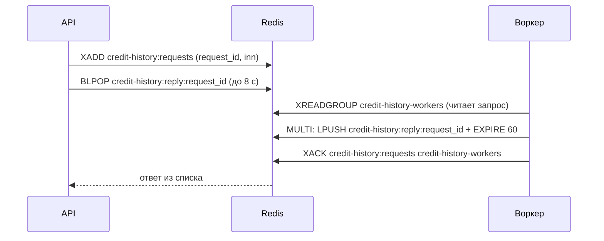

# Обмен API с воркером кредитной истории

Документ описывает контракт между API (Go) и воркером, который по ИНН возвращает кредитную историю. Воркер реализуется отдельно и может быть написан на любом языке: вся связь идёт через Redis. Контракт соответствует коду [`internal/queue/credit_history.go`](../internal/queue/credit_history.go); Go-воркер из `cmd/worker` служит эталонной реализацией и моком для демо.

## Когда это вызывается

Метод `POST /api/v1/me/bootstrap` вызывается клиентом после входа. Если у компании нет показателей долговой нагрузки или они старше 12 часов (`TRUST_REFRESH_INTERVAL`), API обращается к воркеру и ждёт ответа до `WORKER_TIMEOUT` (по умолчанию 8 секунд). Подробный поток описан в [architecture.md](architecture.md#обновление-коэффициента-долговой-нагрузки).

## Схема обмена



Ответ ждём в списке, а не в pub/sub: если воркер ответит раньше, чем API начнёт ждать, ответ не потеряется.

## Запрос (API → воркер)

Сообщение в Redis stream `credit-history:requests`, добавляется командой `XADD` с полями:

| Поле | Тип | Описание |
|---|---|---|
| `request_id` | строка, 32 hex-символа | Уникальный идентификатор запроса; по нему воркер строит ключ ответа |
| `inn` | строка | ИНН компании: 10 цифр у ООО, 12 цифр у ИП |

API обрезает длину stream примерно до 10 000 записей (`MAXLEN ~ 10000`).

## Что делает воркер

1. **Создать группу потребителей** (один раз при старте; ошибку «группа уже существует» `BUSYGROUP` игнорировать). API группу **не создаёт**:
   ```
   XGROUP CREATE credit-history:requests credit-history-workers 0 MKSTREAM
   ```
   Стартовая позиция `0` означает, что воркер обработает и запросы, пришедшие, пока он был выключен.
2. **Читать запросы** через группу, можно запустить несколько воркеров с разными именами потребителей: каждое сообщение достанется одному из них:
   ```
   XREADGROUP GROUP credit-history-workers <имя-потребителя> COUNT 10 BLOCK 5000 STREAMS credit-history:requests >
   ```
3. **Получить кредитную историю** по `inn`.
4. **Ответить** одним сообщением в список `credit-history:reply:<request_id>`. Команды `LPUSH` и `EXPIRE` нужно выполнять **одной транзакцией** (`MULTI` ... `EXEC`): без `EXPIRE` ответ, который API уже не ждёт, останется в Redis навсегда:
   ```
   MULTI
   LPUSH credit-history:reply:<request_id> '{"debt": 2400000, "equity": 4000000}'
   EXPIRE credit-history:reply:<request_id> 60
   EXEC
   ```
5. **Подтвердить сообщение** после отправки ответа, не раньше:
   ```
   XACK credit-history:requests credit-history-workers <id сообщения>
   ```
6. **Периодически забирать «зависшие» сообщения** (рекомендуется): те, что кто-то прочитал, но не подтвердил, например упал. Redis хранит их в списке ожидающих группы, пока их не подтвердят. Команда `XAUTOCLAIM` передаёт текущему потребителю сообщения, которые висят без подтверждения дольше заданного времени (в Go-воркере 30 секунд, проверка раз в 10 секунд):
   ```
   XAUTOCLAIM credit-history:requests credit-history-workers <имя-потребителя> 30000 0-0 COUNT 10
   ```
   Забранные сообщения обрабатываются как обычные (шаги 3–5). Если следующий курсор в ответе не `0-0`, вызов повторяют с ним.

## Ответ (воркер → API)

JSON-объект в списке `credit-history:reply:<request_id>`.

Успех:
```json
{"debt": 2400000, "equity": 4000000}
```

| Поле | Тип | Описание |
|---|---|---|
| `debt` | целое число | Общий долг по всем банкам, рубли |
| `equity` | целое число | Собственный капитал, рубли |

Ошибка:
```json
{"error": "причина"}
```

Если `equity` не больше 0, коэффициент долг / капитал не определён, API сохранит его как `NULL`.

## Как API реагирует

| Ситуация | Что делает API | Что видит клиент `/me/bootstrap` |
|---|---|---|
| Ответ получен | Сохраняет `debt`, `equity`, считает `debt_to_equity` | 200 |
| Воркер не ответил за `WORKER_TIMEOUT`, показатели у компании уже были | Использует прежние значения, пишет предупреждение в лог | 200 со старыми значениями |
| Воркер не ответил, показателей у компании не было | Возвращает ошибку таймаута | 503, `Retry-After: 5` |
| Ответ содержит `error` или это не корректный JSON, показатели у компании уже были | Использует прежние значения, пишет причину в лог | 200 со старыми значениями |
| Ответ содержит `error` или это не корректный JSON, показателей не было | Пишет причину в лог | 503, `Retry-After: 5` |

Ошибка воркера и его молчание обрабатываются одинаково: оба случая считаются «воркер недоступен». Причина (таймаут, текст `error` или ошибка разбора ответа) попадает только в лог API, клиент её не видит.

Проверено на запущенном стеке: ответ `{"error": ...}` и не-JSON дают 200 со старыми данными (когда они были) или 503 (когда не было), молчание воркера даёт то же самое.

## Особенности

- **Повторные запросы.** Несколько клиентов одной компании внутри одного экземпляра API делятся одним запросом (`singleflight`), но при нескольких экземплярах API или после таймаута один и тот же ИНН может прийти несколько раз с разными `request_id`. Каждый запрос нужно обработать независимо.
- **Запоздалые ответы.** API ждёт не дольше 8 секунд. Если воркер ответил позже, ответ остаётся в списке до истечения `EXPIRE` и безвреден.
- **Накопившиеся запросы.** После простоя воркер получит все накопившиеся запросы, и ответы на уже неактуальные просто истекут по `EXPIRE`.
- **Необработанные сообщения.** Сообщение, которое воркер прочитал, но не подтвердил (например, упал), в группе остаётся «зависшим». Go-воркер забирает такие сообщения обратно через 30 секунд (шаг 6) и обрабатывает; проверено: после имитации падения 5 зависших сообщений были обработаны за 34 секунды. Для API это безопасно и без дочитки: клиент к этому моменту уже получил 503 или старые данные.
- **Авторизация и TLS в Redis** сейчас не используются.

## Ручная проверка без воркера

Позволяет «сыграть» воркера командами `redis-cli`. В примере воркер в compose остановлен (`docker compose stop worker`), а клиент `+79990000002` (данных у компании нет) уже получил токен (см. [requests.http](requests.http)).

1. В одном терминале вызвать `POST /api/v1/me/bootstrap`: запрос повиснет на несколько секунд.
2. В другом терминале быстро (в пределах 8 секунд) найти запрос:
   ```bash
   docker compose exec redis redis-cli XREVRANGE credit-history:requests + - COUNT 1
   ```
   В выводе третья строка это `request_id`, пятая `inn`.
3. Положить ответ, подставив `request_id`:
   ```bash
   docker compose exec redis redis-cli LPUSH credit-history:reply:ВАШ_REQUEST_ID '{"debt":2400000,"equity":4000000}'
   ```
4. Первый терминал вернёт 200 с коэффициентом 0,6. Вместо JSON с суммами можно положить `{"error":"boom"}`: для компании без данных будет 503, для компании с устаревшими данными (клиент `+79990000003`) 200 со старыми значениями.

Эта процедура проверена на реальном стеке.

## Открытые вопросы

- Как воркер должен отвечать на неизвестный ИНН: сейчас любое поле `error` трактуется как временная недоступность, и клиент без данных получает 503 с просьбой повторить. Различать «временная ошибка» и «ИНН не существует» API пока не умеет; для этого понадобился бы код ошибки в ответе воркера.
- Нужны ли воркеру дополнительные поля (список кредитов, просрочки, число запросов за 90 дней): место для них в базе есть (`companies.credit_history`, jsonb), см. [data-model.md](data-model.md).
- Нужна ли аутентификация воркера в Redis.
